<p align="center">
  
</p>

<h1 align="center">Enjoy Git</h1>

<p align="center">A clearer view of your everyday Git workflow.</p>

<p align="center">
  <a href="README.md">简体中文</a> · <a href="README.zh-HK.md">繁體中文</a> · <strong>English</strong>
</p>

<p align="center">
  <a href="https://github.com/huangcs427/enjoy-git-release/releases/latest">Download</a> · <a href="https://enjoygit.com">Website</a> · <a href="https://github.com/huangcs427/enjoy-git-release/issues">Report an issue</a>
</p>

Enjoy Git is a desktop Git client for **macOS, Windows, and Linux**, bringing code review, commit history, and conflict resolution into one visual workspace.

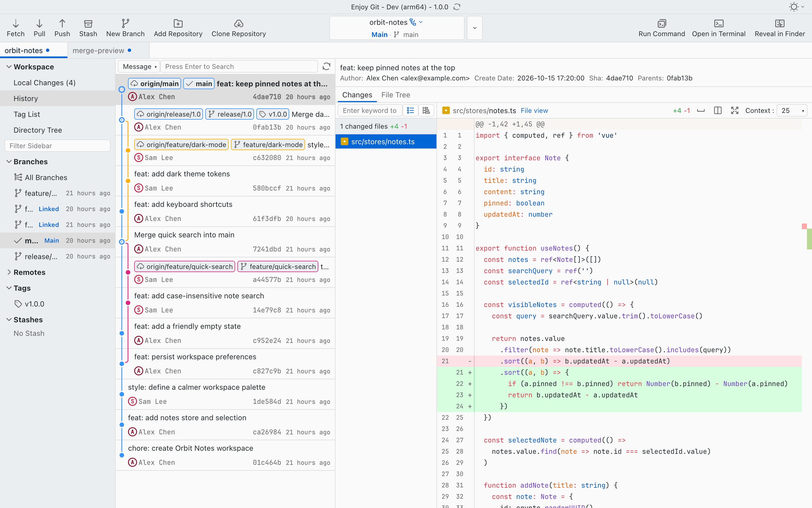

## Download & install

Get the installer for your operating system and processor from [GitHub Releases](https://github.com/huangcs427/enjoy-git-release/releases/latest).

| Platform | Installer | Architectures |
| --- | --- | --- |
| Windows | `.exe` | x64, arm64 |
| macOS | `.dmg` | x64 (Intel), arm64 (Apple Silicon) |
| Linux | `.deb`, `.rpm` | x64, arm64 |

Windows and macOS **include Git**. On Linux, install system Git before using the app.

## Getting started

1. **Open a project**: add a local repository, clone a remote, or scan a directory to import repositories.
2. **Prepare a commit**: review Local Changes, stage files or selected lines, then enter a title and description and commit.
3. **Sync and collaborate**: configure a remote and an upstream branch to fetch, pull, and push. Create worktrees to work on several tasks in parallel.

## Feature tour

Click any image to view it at full size.

[Repositories & project organization](#repositories) · [Working directory, diffs & line staging](#changes) · [Commit history & Git Graph](#history) · [Cherry-pick & history editing](#cherry-pick) · [File history & line-by-line Blame](#file-history) · [Branches, remotes, tags & stashes](#branches) · [Worktree switching & parallel development](#worktrees) · [In-file conflict resolution & three-way merge](#conflicts) · [Search, replace & editing](#search) · [AI commit messages](#ai) · [Integrated terminal & command pipelines](#commands) · [Submodules & connection settings](#submodules)

<a id="repositories"></a>

### Repositories & project organization

Create, clone, or add repositories, or scan a directory to find projects. Assign aliases and groups, then search and switch projects through tabs or the quick switcher.

[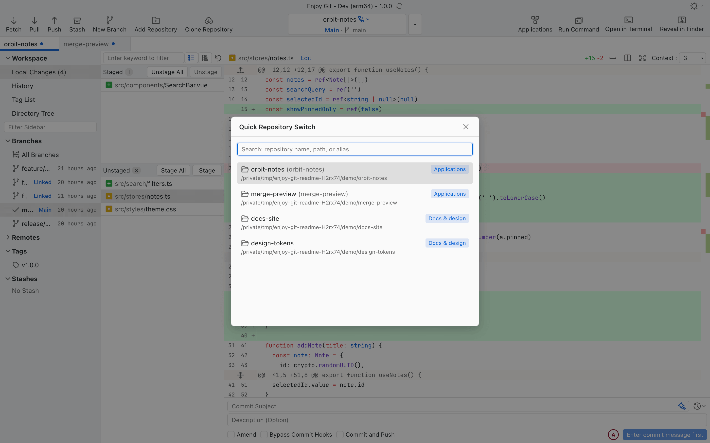](docs/images/repositories-en.png)

<a id="changes"></a>

### Working directory, diffs & line staging

Staged and unstaged files appear separately, with list and tree layouts. Review changes in unified or side-by-side diffs with syntax highlighting, whitespace options, expandable context, and image and SVG previews.

[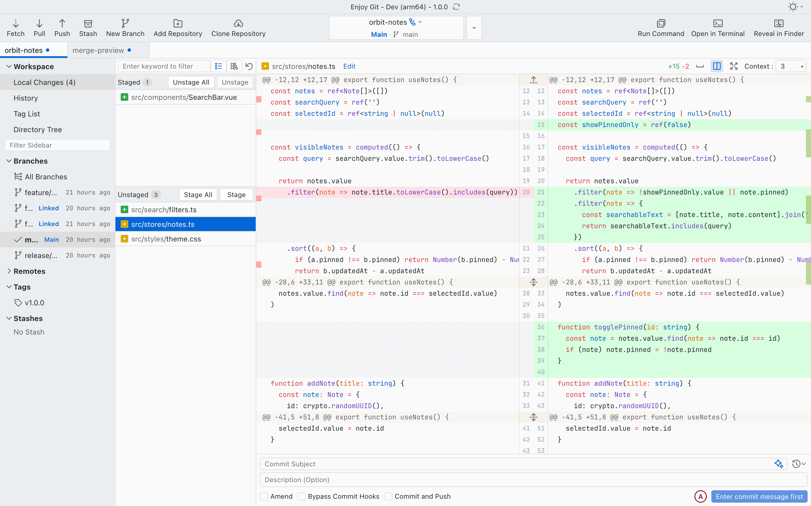](docs/images/workspace-en.png)

**Commit part of a change**: select the lines you need in a diff and choose **Stage Selected Changes** from the context menu. You can also unstage selected lines or discard unstaged changes by line.

[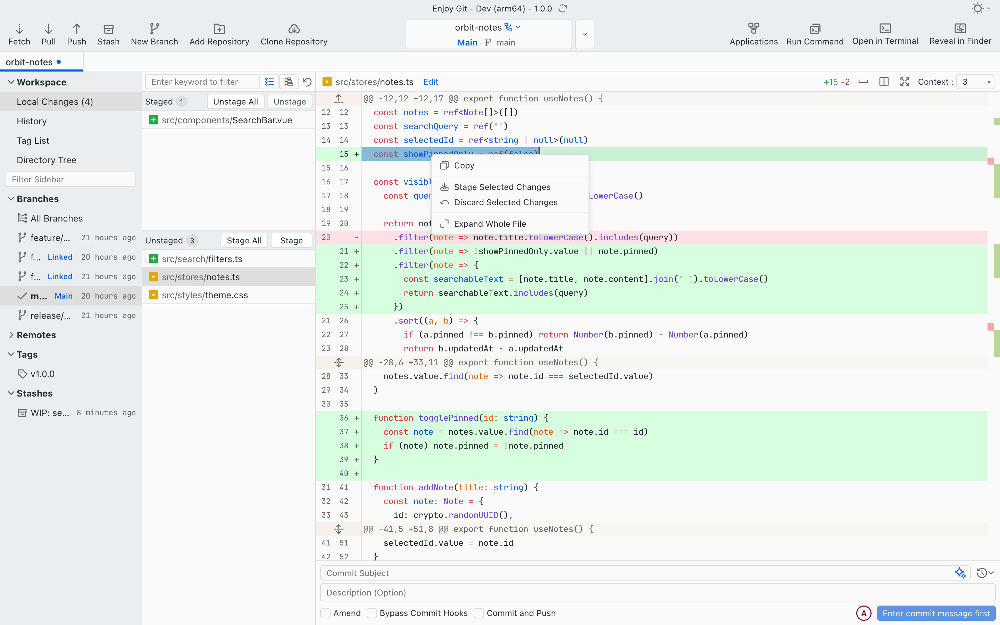](docs/images/line-staging-en.png)

**Commit and amend**: enter a title and description, or open the history button to reuse a recent message and adjust it for the current change. The form supports Amend, bypassing commit hooks, and committing with a push. Click the commit identity to change the name and email.

[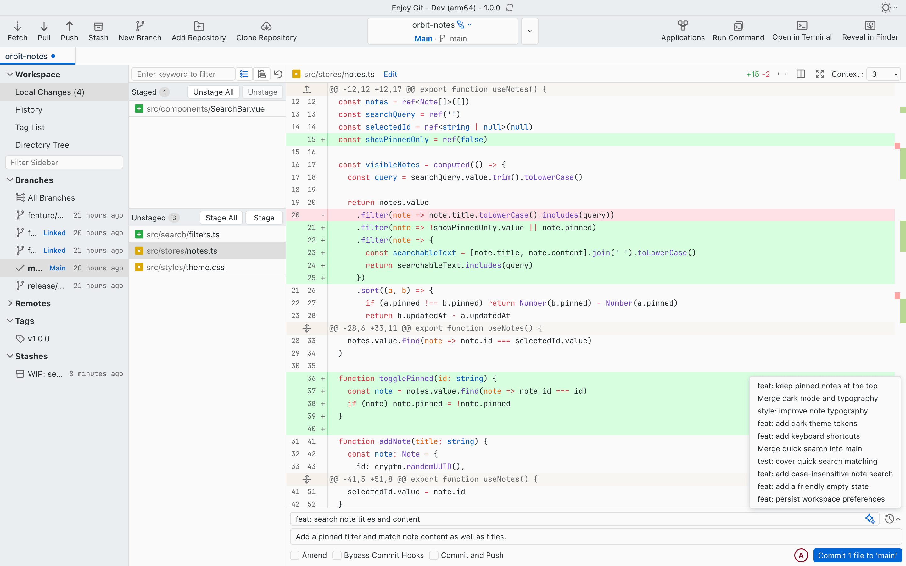](docs/images/commit-message-en.png)

<a id="history"></a>

### Commit history & Git Graph

The branch graph shows commits, forks, merges, tags, and local and remote branch positions. Select a commit to inspect its author, time, SHA, changed files, and diffs, or switch to the file tree to browse that revision.

**Search history** by commit message, diff content, or author. See the match count and move between results with Enter / Shift + Enter.

[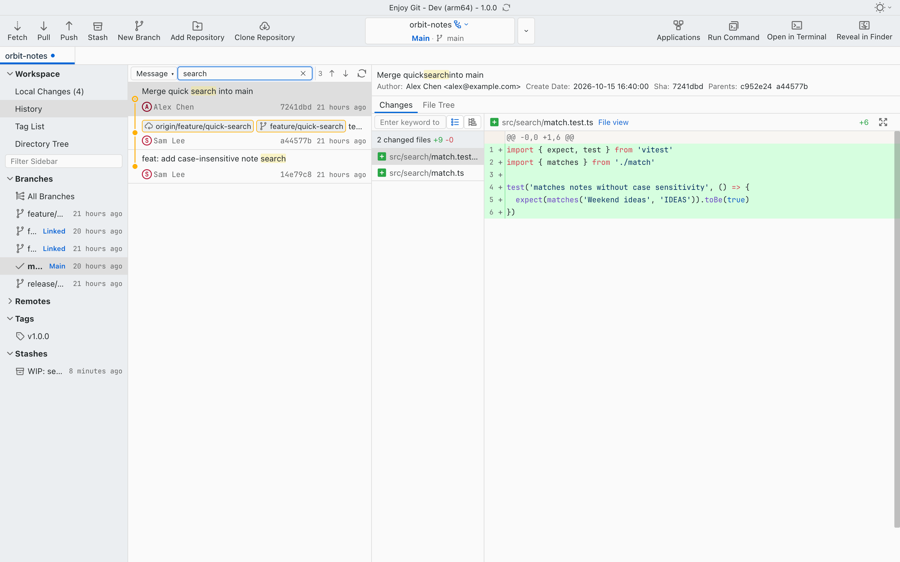](docs/images/history-search-en.png)

<a id="cherry-pick"></a>

### Cherry-pick & history editing

**Cherry-pick** applies selected commits to a target branch. Use Cmd-click on macOS or Ctrl-click on Windows and Linux for multiple selections, or Shift-click for a range. Open **Cherry-pick** from the context menu and choose a destination. Multiple commits are applied from oldest to newest. If the destination branch is checked out in another worktree, the app prompts you to switch there first.

[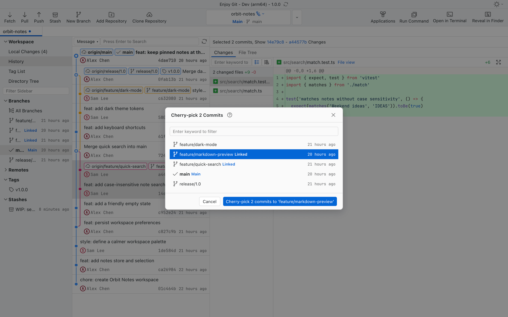](docs/images/cherry-pick-en.png)

The commit context menu also offers Revert, undoing the latest commit, Squash, message editing, reordering, and deletion. Available actions depend on the current branch, commit position, and selection. Branch menus include merge and rebase actions.

<a id="file-history"></a>

### File history & line-by-line Blame

**File history**: choose **History** from a file's context menu to inspect its commits and diffs in a separate window, with branch and keyword filters.

[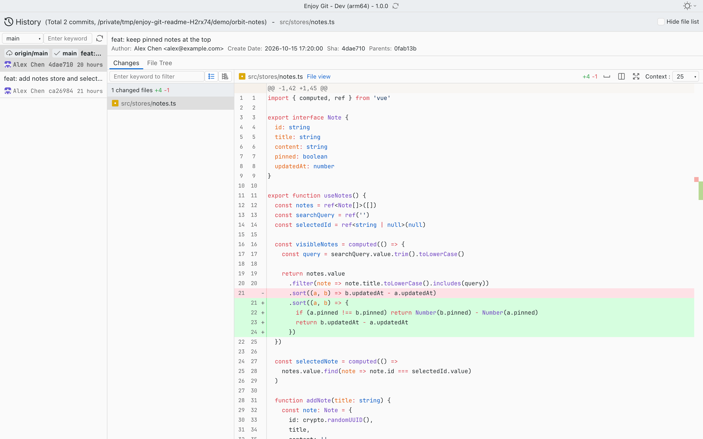](docs/images/file-history-en.png)

**Blame** shows the commit, author, and date responsible for each line. Click a commit attribution to highlight its code lines, and use the file's commit list to trace how the code evolved.

[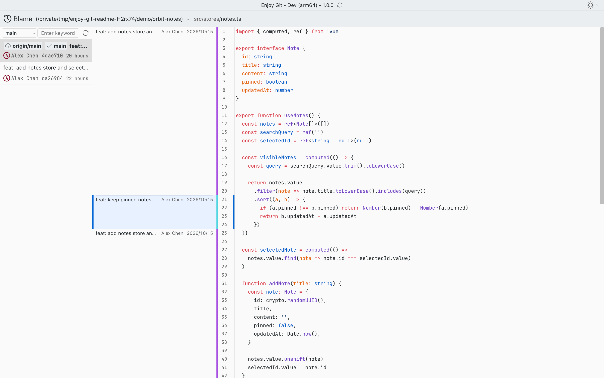](docs/images/blame-en.png)

<a id="branches"></a>

### Branches, remotes, tags & stashes

Create, check out, rename, and delete branches; manage upstreams and multiple remotes; and sync with Fetch / Pull / Push. The push dialog lets you choose the local branch, remote, and destination branch explicitly. Create, browse, check out, and delete tags.

[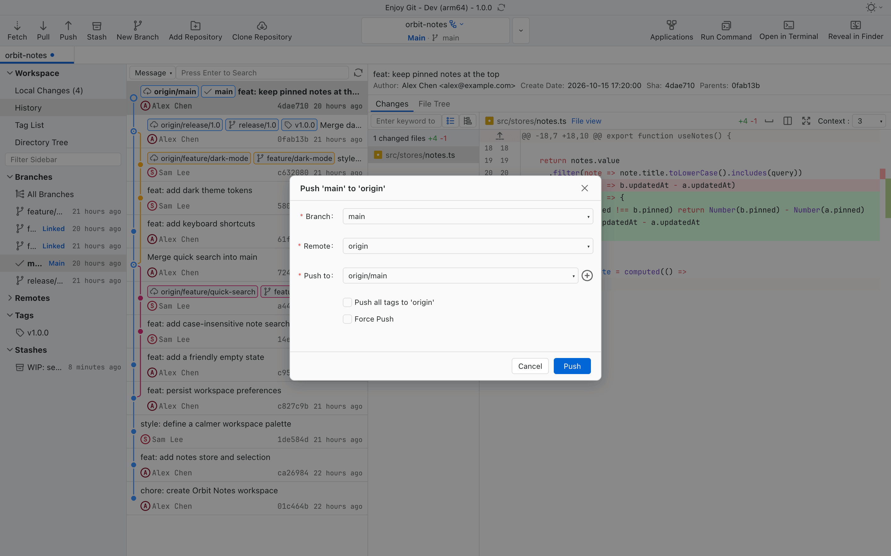](docs/images/branch-sync-en.png)

**Stash** saves unfinished work so you can return to it later. Inspect its files and diffs before choosing Apply, Pop, or Delete, making it easier to pause a task before switching focus.

[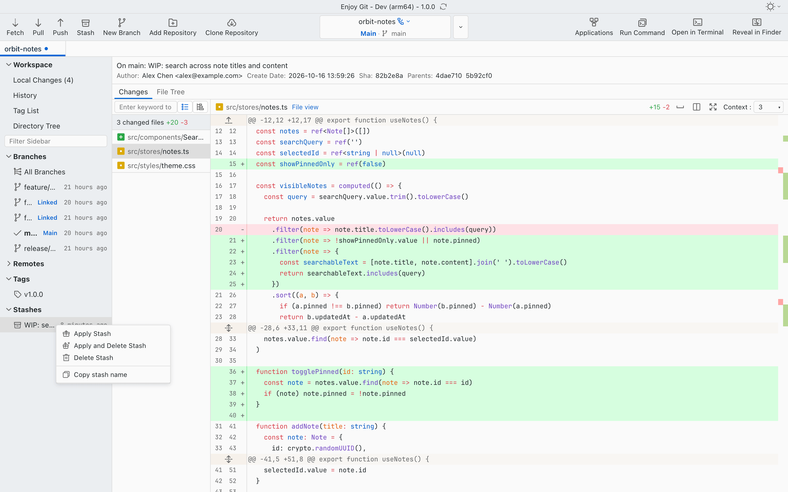](docs/images/stash-en.png)

<a id="worktrees"></a>

### Worktree switching & parallel development

Git worktrees give different branches of one repository their own working directories. Keep changes for one task in place while working on a fix or feature in another directory.

**Switch existing worktrees** by clicking the repository area at the top. The list shows each directory and branch and marks the current entry. This example has switched to the worktree for `feature/quick-search`; the main worktree remains available in the same list.

[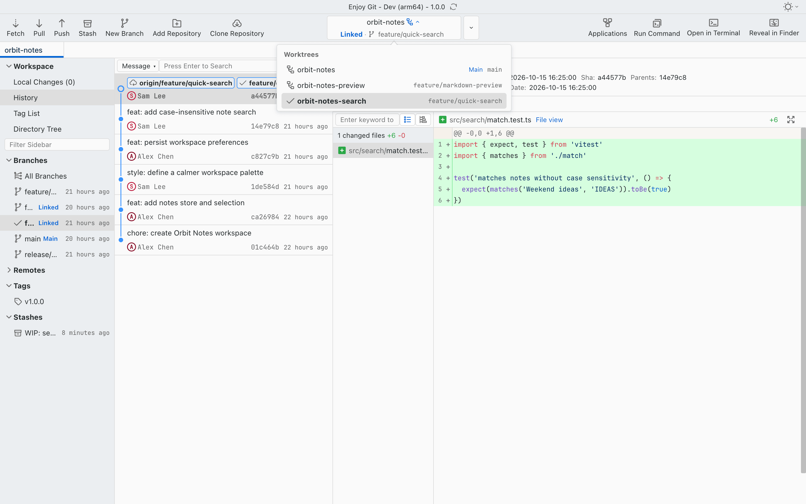](docs/images/worktree-switch-en.png)

**Create a worktree** from the repository context menu with **Add Worktree**, then choose a directory and branch. You can create a new branch and optionally reuse Git-ignored directories and files. The app switches to the new worktree after creation.

[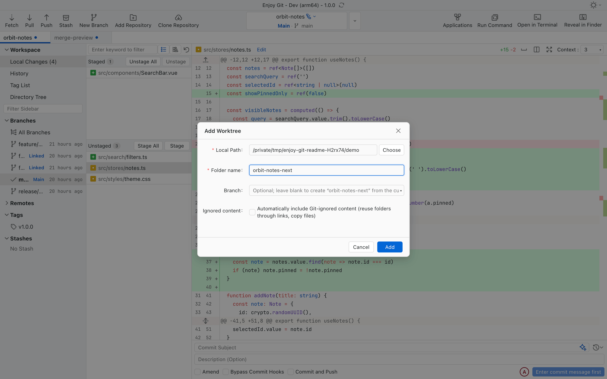](docs/images/worktrees-en.png)

<a id="conflicts"></a>

### In-file conflict resolution & three-way merge

For text conflicts during a merge, pull, rebase, or cherry-pick, choose in-file actions, direct editing, or the three-way merge editor.

**Resolve directly in the conflict file**: select the file in Local Changes to inspect its highlighted conflict markers. Choose **Use current change**, **Use incoming change**, or **Keep both changes** for each block. Navigate between conflicts, or use **Batch actions** to choose one side for all unresolved blocks.

[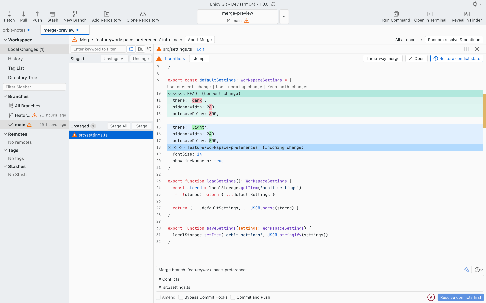](docs/images/conflict-inline-en.png)

**Edit the conflict file manually**: click **Edit** above the file, combine the required logic, remove conflict markers, and save. This screenshot shows a manually combined draft and its Save action.

[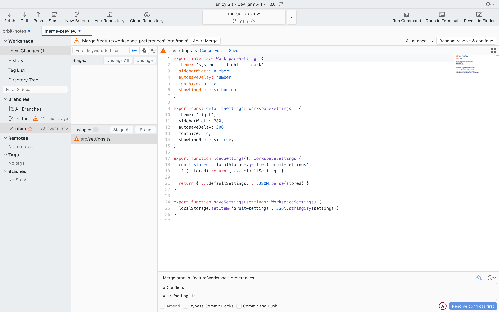](docs/images/conflict-edit-en.png)

**Three-way merge**: open the three-way editor to compare both versions alongside an editable result. Select a side, combine changes, or edit the result, with version comparison, undo, and redo.

[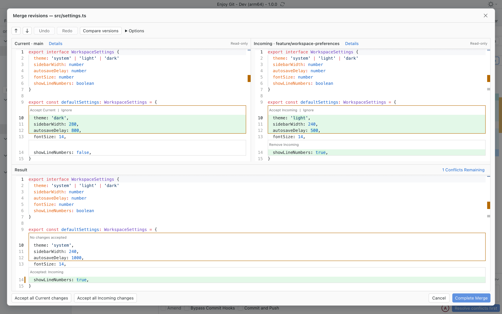](docs/images/merge-en.png)

**Finish resolving**: once the conflicts are gone, stage the result and follow the prompt to continue the current Git operation. When the working directory and staging area are combined, use **Mark as Resolved**. The conflict banner offers step-by-step undo, and the file toolbar can restore the conflict state. Continue, Skip, and Abort actions appear for the relevant operation.

<a id="search"></a>

### Search, replace & editing

Search file names or contents from the directory tree, with case, whole-word, and regular expression options. Open a match at its code line, then view, replace, and save text in the built-in editor. Saved edits appear in the Git working directory.

[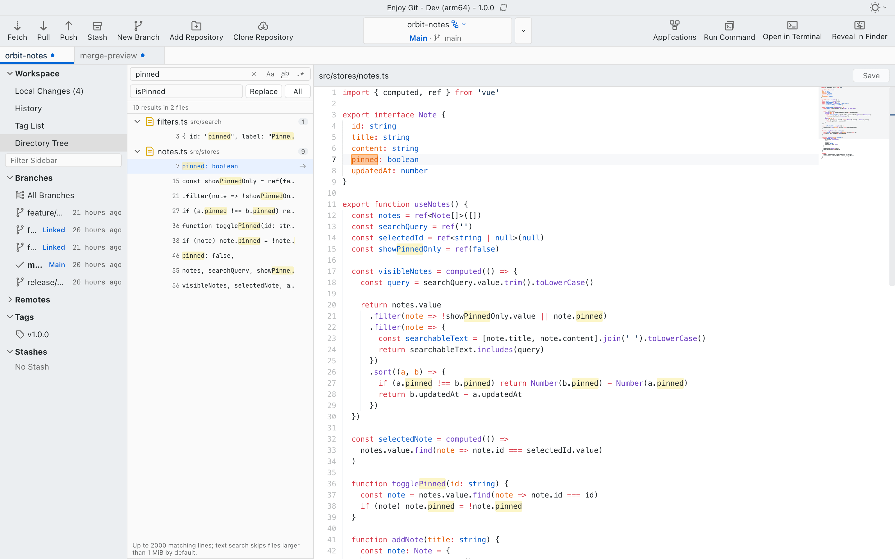](docs/images/search-en.png)

<a id="ai"></a>

### AI commit messages

Configure a model service to generate commit messages from code changes. Set the model and endpoint, API key, output language, context length, extra instructions, and ignored file rules. Review and edit the generated message before committing.

[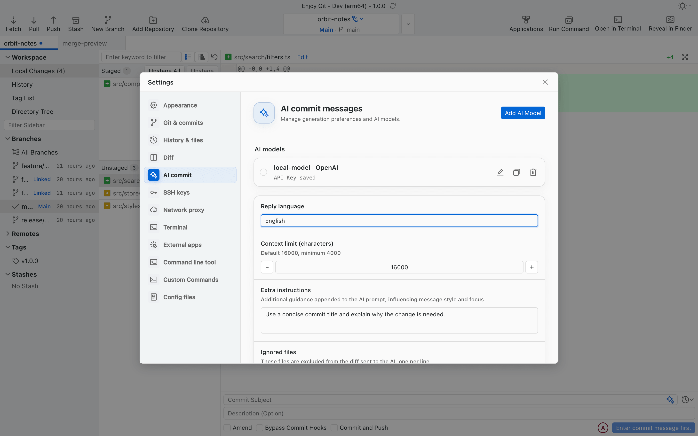](docs/images/ai-en.png)

<a id="commands"></a>

### Integrated terminal & command pipelines

Open the integrated terminal in the current repository to run Git or project commands. You can also configure a system or custom terminal and open repositories through the command-line entry point.

[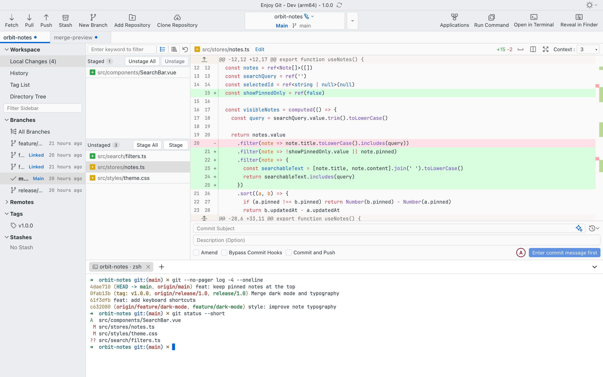](docs/images/terminal-en.png)

**Custom commands** can be scoped to repositories and combine local commands, SFTP uploads, and remote commands into a pipeline. The task center keeps run history, status, and output for repeatable checks or deployment steps.

[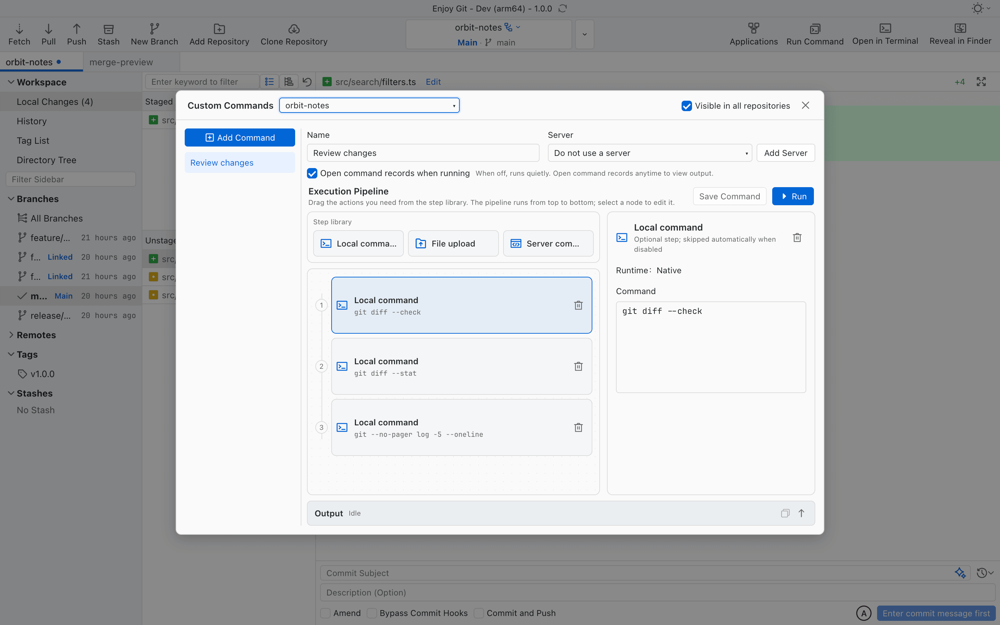](docs/images/commands-en.png)

<a id="submodules"></a>

### Submodules & connection settings

Clone recursively, add submodules, inspect their status, and check out revisions. Submodule diffs show pointer changes and the associated commits; open the submodule repository to continue working in it.

[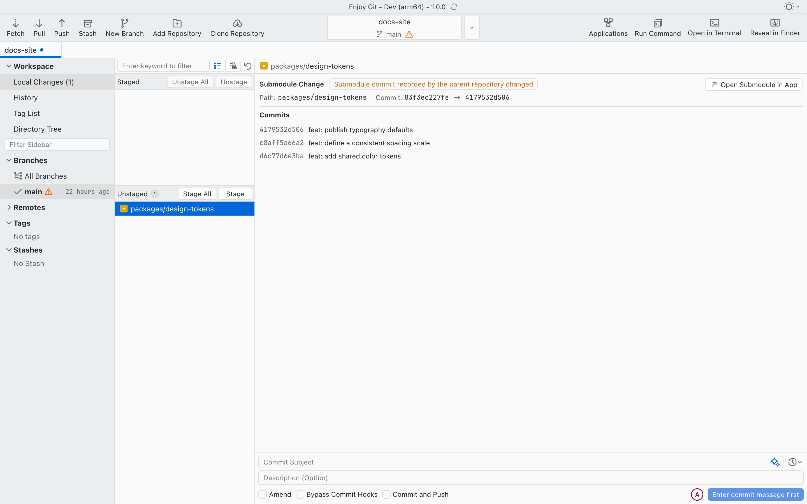](docs/images/submodules-en.png)

Connection and environment settings also cover **SSH key management, GitHub authentication, network proxies, and external programs**. On Windows, you can access **WSL repositories**.

## Language & theme

Available in English, Simplified Chinese, and Traditional Chinese, with light, dark, and system themes.

<details>
<summary>View the dark theme</summary>

[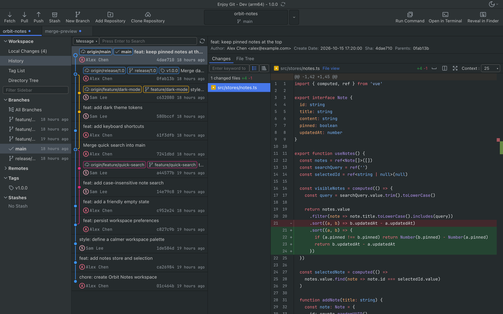](docs/images/theme-dark-en.png)

</details>

## dugite-native & bundled Git source

Git bundled with Windows and macOS is provided by [dugite-native](https://github.com/desktop/dugite-native). The current resource configuration pins `v2.53.0-4`. See [Third-Party Notices](THIRD_PARTY_NOTICES.md#dugite-native-and-bundled-git) for the pinned upstream source and build instructions, and the [full GPL-2.0 license](docs/licenses/dugite-native-GPL-2.0.txt).

The invocation example below covers Git paths, environment variables, and process spawning. It is also available as a [source file](docs/dugite-native-usage.ts).

<details>
<summary>Show the dugite-native invocation source</summary>

```ts
/**
 * Bundled Git uses dugite-native
 * https://github.com/desktop/dugite-native
 */
import { spawn } from 'child_process';
import * as fs from 'fs-extra';
import * as path from 'path';

const getWin32GitSubfolder = (arch?: string): string => {
  const archRes = arch || process.arch
  if (archRes === 'x64') return 'mingw64'
  if (archRes === 'arm64') return 'clangarm64'
  return 'mingw32'
}

interface TObjectValue { [key: string]: any }

const getGitPathAndGitEnv = (envTemp?: TObjectValue) => {
  let env = { ...process.env, ...(envTemp || {}) }
  const gitFolder = path.join(__dirname, 'git')
  let gitPath = ''
  if (process.platform === 'win32') {
    const win32GitSubfolder = getWin32GitSubfolder()
    gitPath = path.join(gitFolder, 'cmd', 'git.exe')
    env.GIT_EXEC_PATH = path.join(gitFolder, win32GitSubfolder, 'libexec', 'git-core')
    env.PATH = `${gitFolder}\\${win32GitSubfolder}\\bin;${gitFolder}\\usr\\bin;${env.PATH ?? ''}`
  } else {
    gitPath = path.join(gitFolder, 'bin', 'git')
    env.GIT_CONFIG_SYSTEM = path.join(gitFolder, 'etc', 'gitconfig')
    env.GIT_EXEC_PATH = path.join(gitFolder, 'libexec', 'git-core')
    env.GIT_TEMPLATE_DIR = path.join(gitFolder, 'share', 'git-core', 'templates')
  }
  if (!fs.existsSync(gitPath)) {
    env = { ...envTemp }
    gitPath = 'git'
  }
  return { env, gitPath }
}

export const git = (args: string[], options: TObjectValue) => {
  if (!options) options = {}
  const { gitPath, env } = getGitPathAndGitEnv(options.env)
  options.env = env
  return spawn(gitPath, args, options)
}
```

</details>

## Acknowledgements

- Portions of the Git Graph layout and SVG rendering are adapted from [VS Code (Code - OSS)'s Source Control History Graph](https://github.com/microsoft/vscode/blob/25c94ab342a6b167d4b97ade0829955d4f7e094e/src/vs/workbench/contrib/scm/browser/scmHistory.ts), licensed under MIT. See [Third-Party Notices](THIRD_PARTY_NOTICES.md) for the source revision, copyright, and full license.
- Git bundled with Windows and macOS is provided by [dugite-native](https://github.com/desktop/dugite-native).

Feedback: [GitHub Issues](https://github.com/huangcs427/enjoy-git-release/issues) · [Email](mailto:huangcs427@163.com) · [Privacy policy](https://enjoygit.com/privacyPolicy.html)
