<p align="center">
  
</p>

<h1 align="center">Enjoy Git</h1>

<p align="center">让日常 Git 操作更直观。</p>

<p align="center">
  <strong>简体中文</strong> · <a href="README.zh-HK.md">繁體中文</a> · <a href="README.en.md">English</a>
</p>

<p align="center">
  <a href="https://github.com/huangcs427/enjoy-git-release/releases/latest">下载最新版本</a> · <a href="https://enjoygit.com">官网</a> · <a href="https://github.com/huangcs427/enjoy-git-release/issues">反馈问题</a>
</p>

Enjoy Git 是一款适用于 **macOS、Windows 和 Linux** 的桌面 Git 客户端，把代码差异、提交历史和冲突处理放在直观的界面里。

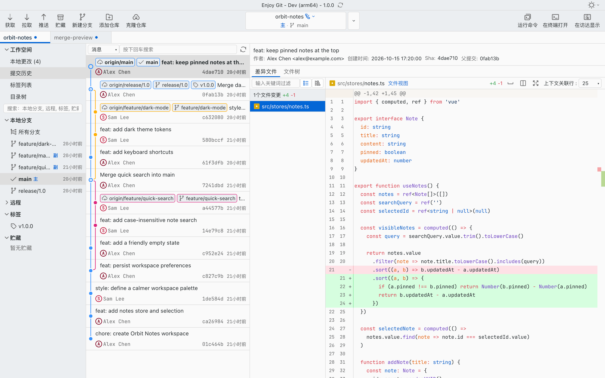

## 下载与安装

从 [GitHub Releases](https://github.com/huangcs427/enjoy-git-release/releases/latest) 下载适合你的系统和处理器架构的安装包。

| 平台 | 安装包 | 架构 |
| --- | --- | --- |
| Windows | `.exe` | x64、arm64 |
| macOS | `.dmg` | x64（Intel）、arm64（Apple Silicon） |
| Linux | `.deb`、`.rpm` | x64、arm64 |

Windows 和 macOS **内置 Git**，安装后即可使用；Linux 需先安装系统 Git。

## 快速开始

1. **打开项目**：添加本地仓库、克隆远程仓库，或扫描目录批量导入。
2. **准备提交**：在“本地更改”中审阅差异，按文件或选中行暂存，填写提交标题和正文后提交。
3. **同步与协作**：配置远程和跟踪分支后获取、拉取、推送；需要并行处理多个任务时创建工作树。

## 功能导览

以下截图均为简体中文浅色界面，点击可查看原图。深色主题示例位于文末的“语言与主题”。

[仓库接入与项目组织](#repositories) · [工作区、差异与按行暂存](#changes) · [提交历史与 Git Graph](#history) · [遴选与历史整理](#cherry-pick) · [文件历史与按行审阅](#file-history) · [分支、远程、标签与贮藏](#branches) · [工作树切换与并行开发](#worktrees) · [文件内冲突处理与三栏合并](#conflicts) · [全文搜索、替换与编辑](#search) · [AI 提交消息](#ai) · [内置终端与命令流水线](#commands) · [子模块与连接设置](#submodules)

<a id="repositories"></a>

### 仓库接入与项目组织

支持新建仓库、克隆、添加本地仓库，以及扫描目录。项目可设置别名并按组整理，在标签页或快速切换窗口中搜索和切换。

[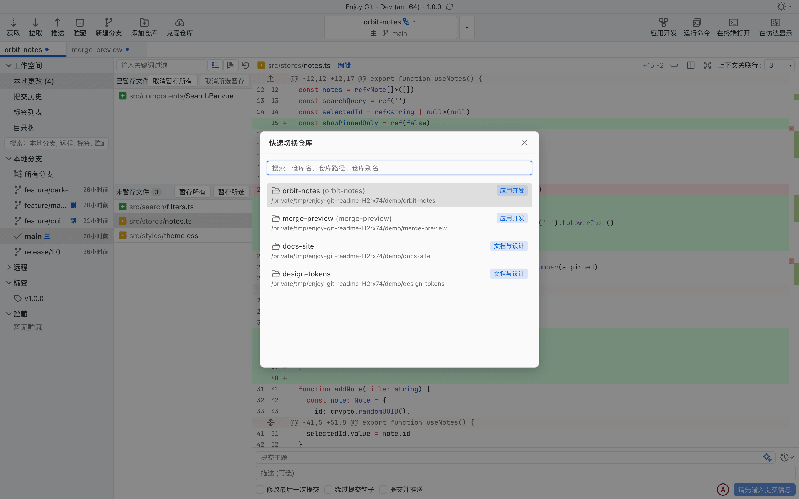](docs/images/repositories-zh-CN.png)

<a id="changes"></a>

### 工作区、差异与按行暂存

已暂存与未暂存文件分区显示，可使用列表或文件树。差异支持统一 / 并排视图、语法高亮、忽略空白字符、展开上下文，以及图片和 SVG 预览。

[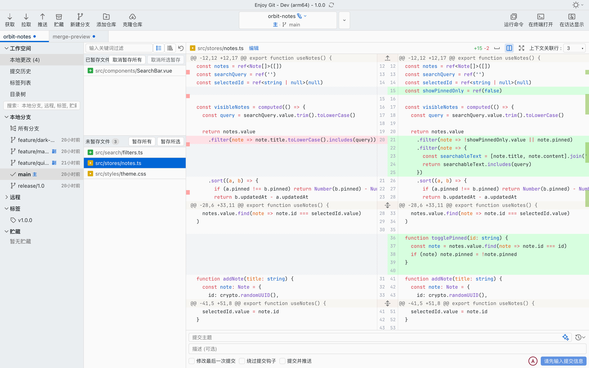](docs/images/workspace-zh-CN.png)

**只提交一部分修改**：在 diff 中选中需要的代码行，右键选择“将选中行加入暂存区”；已暂存内容也可按行移出，未暂存内容可按行丢弃。

[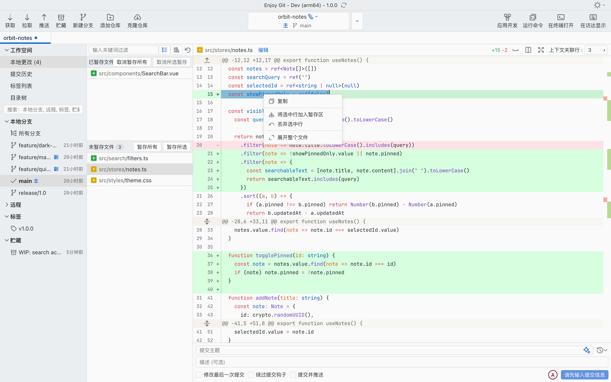](docs/images/line-staging-zh-CN.png)

**提交与修订**：填写提交标题与正文，也可点击历史按钮复用最近的提交消息，再按本次修改调整。表单支持修改最后一次提交（Amend）、绕过提交钩子和提交并推送；点击提交身份可修改姓名和邮箱。

[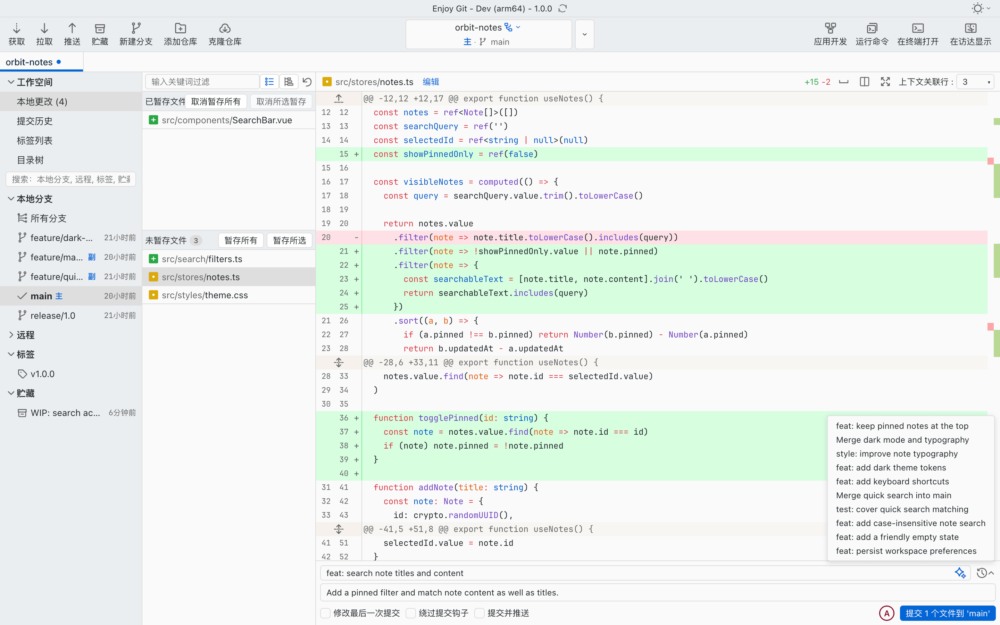](docs/images/commit-message-zh-CN.png)

<a id="history"></a>

### 提交历史与 Git Graph

分支提交图展示提交、分叉、合并、标签以及本地 / 远程分支的位置。选择提交即可查看作者、时间、SHA、变更文件和代码差异，也可切到文件树浏览该版本的内容。

**搜索历史**：可按提交消息、差异内容或作者查找，查看匹配数量，并用 Enter / Shift + Enter 在结果间跳转。

[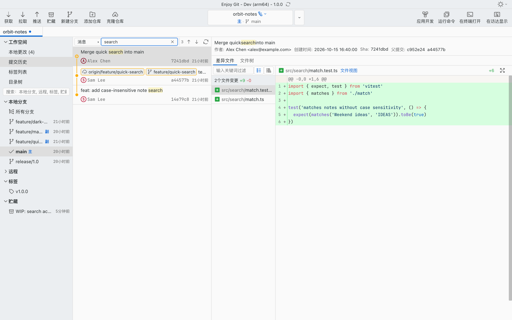](docs/images/history-search-zh-CN.png)

<a id="cherry-pick"></a>

### 遴选与历史整理

**遴选（Cherry-pick）** 将选中的提交应用到目标分支。使用 Cmd（macOS）/ Ctrl（Windows、Linux）点击多选，或使用 Shift 连续选择，右键打开“遴选提交”，再选择目标分支。多个提交会按先旧后新的顺序应用；如果目标分支已在另一个工作树检出，会先提示切换到该工作树。

[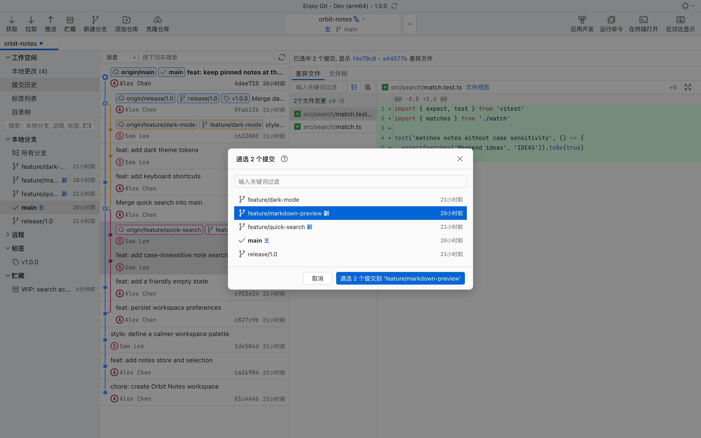](docs/images/cherry-pick-zh-CN.png)

提交右键菜单还提供撤销提交（Revert）、撤回最近提交、合并提交（Squash）、编辑提交消息、重排和删除提交等操作；可用项会随当前分支、提交位置和选区变化。分支菜单支持合并和变基（Rebase）。

<a id="file-history"></a>

### 文件历史与按行审阅

**文件历史**：在文件右键菜单中选择“查看文件历史记录”，在独立窗口里逐次查看该文件的提交与 diff，并按分支和关键词筛选。

[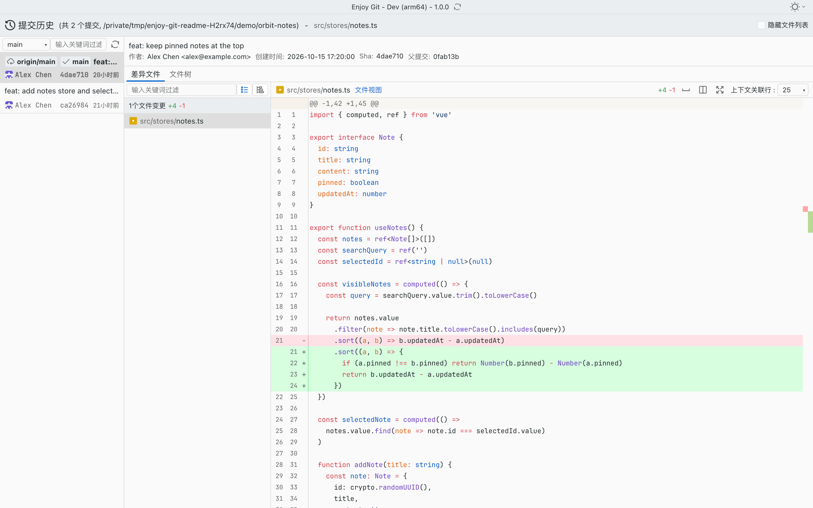](docs/images/file-history-zh-CN.png)

**按行审阅（Blame）**：查看每一行最后修改它的提交、作者和日期。点击左侧的提交归属可突出显示对应代码行，并与文件提交列表对照，定位一段代码的来历。

[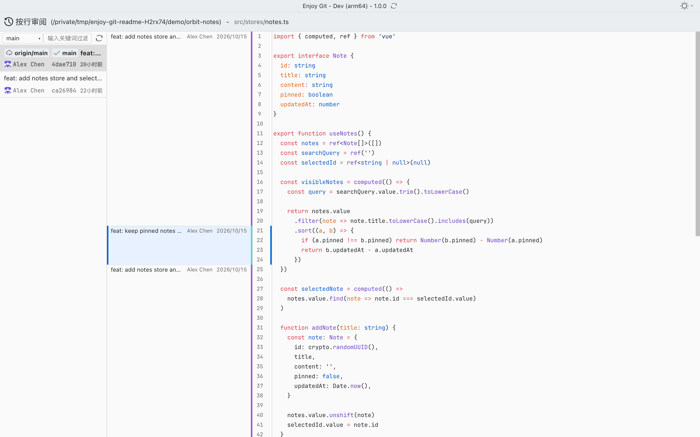](docs/images/blame-zh-CN.png)

<a id="branches"></a>

### 分支、远程、标签与贮藏

支持创建、检出、重命名和删除分支，管理跟踪关系与多个远程，并使用 Fetch / Pull / Push 同步。推送前可明确选择本地分支、远程和目标分支；标签支持创建、浏览、检出和删除。

[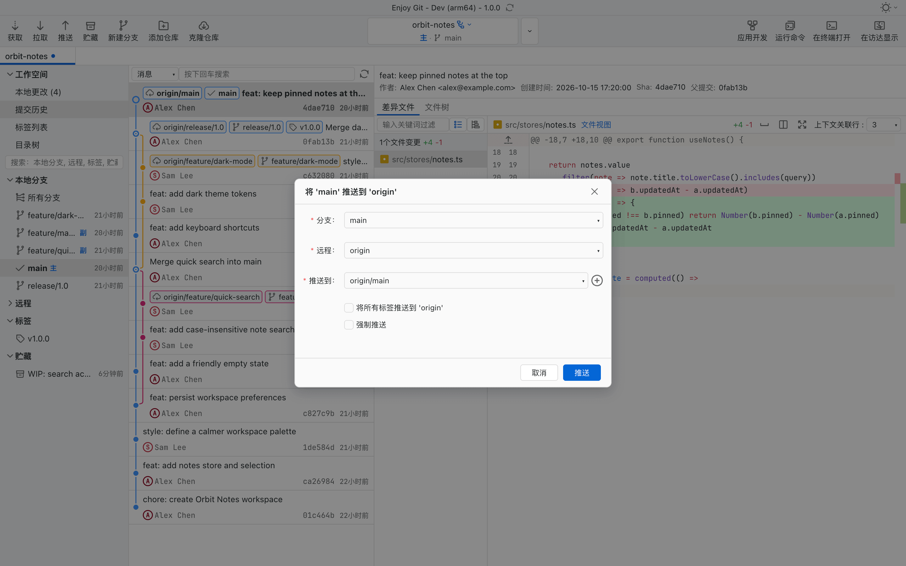](docs/images/branch-sync-zh-CN.png)

**贮藏（Stash）** 可以暂存手头任务，之后查看保存的文件与差异，再选择应用、弹出或删除。适合在切换工作内容前保存尚未提交的修改。

[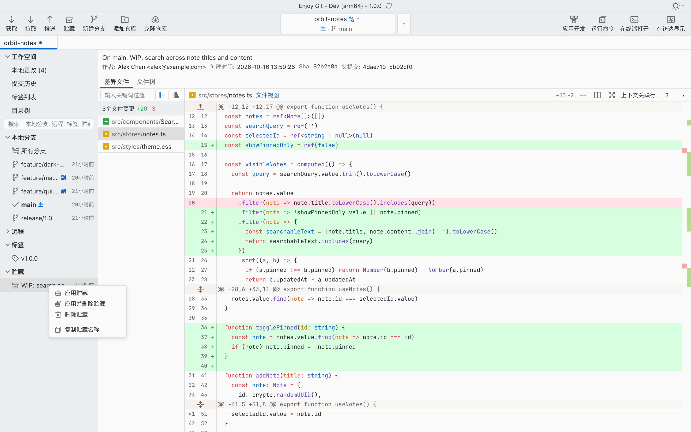](docs/images/stash-zh-CN.png)

<a id="worktrees"></a>

### 工作树切换与并行开发

工作树（Git Worktree）让同一个仓库的不同分支分别拥有自己的工作目录。可以保留当前任务的修改，同时在另一个目录处理修复或新功能。

**切换已有工作树**：点击顶部仓库区域，列表会同时显示工作目录与分支，并标记当前项。下图已切到 `feature/quick-search` 所在工作树，可随时切回主工作树。

[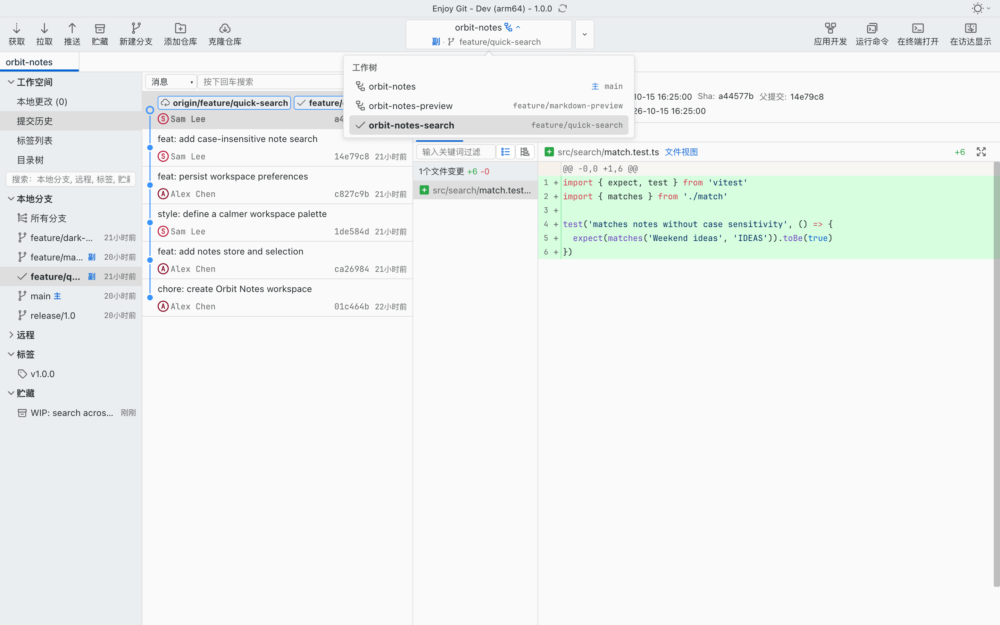](docs/images/worktree-switch-zh-CN.png)

**创建工作树**：右键仓库入口选择“添加工作树”，指定目录和分支；也可新建分支，并按需复用 Git 忽略的目录和文件。创建完成后会切换到新工作树。

[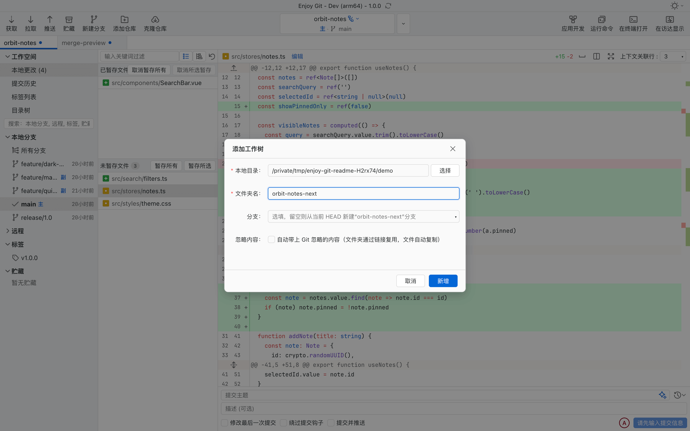](docs/images/worktrees-zh-CN.png)

<a id="conflicts"></a>

### 文件内冲突处理与三栏合并

合并、拉取、变基、遴选等操作产生文本冲突时，可根据需要选择文件内选边、手动编辑或三栏合并。

**直接在冲突文件中解决**：在“本地更改”中选中冲突文件，查看高亮的冲突标记，逐块点击“采用当前更改”“采用传入的更改”或“保留双方更改”。多处冲突可前后跳转，也可通过“批量处理”统一选边。

[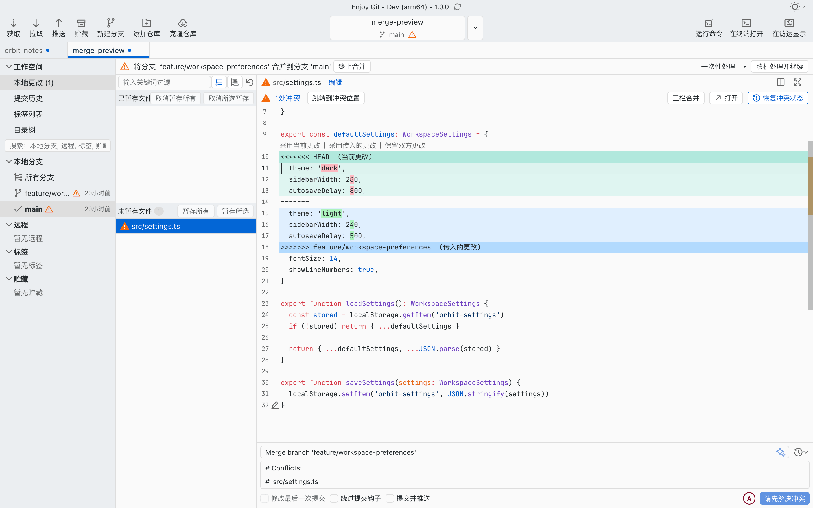](docs/images/conflict-inline-zh-CN.png)

**手动编辑冲突文件**：点击文件上方的“编辑”，直接修改文件内容，整合双方逻辑并清理冲突标记，再保存结果。下图展示手动整合设置后的草稿与保存入口。

[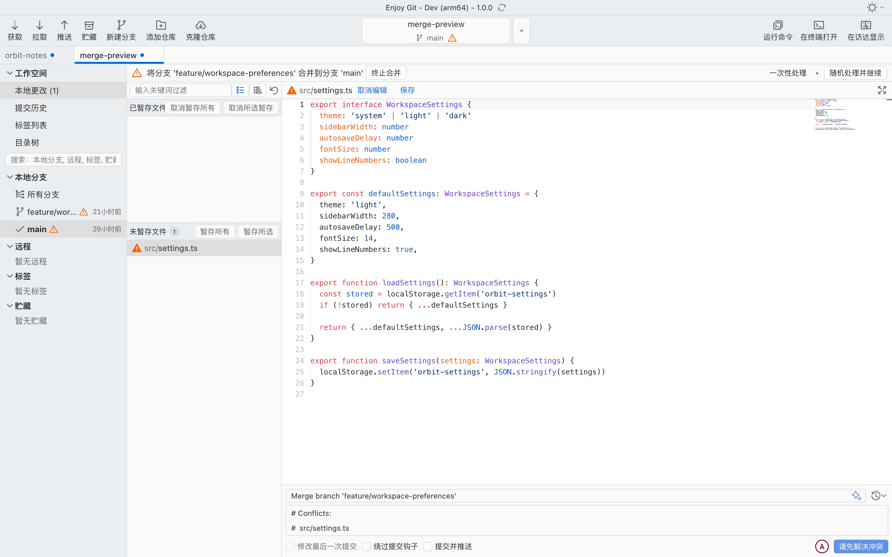](docs/images/conflict-edit-zh-CN.png)

**三栏合并**：需要对照双方版本时，打开“三栏合并”，在双方内容和可编辑结果之间比较、选边或组合修改。支持版本比较、撤销 / 重做。

[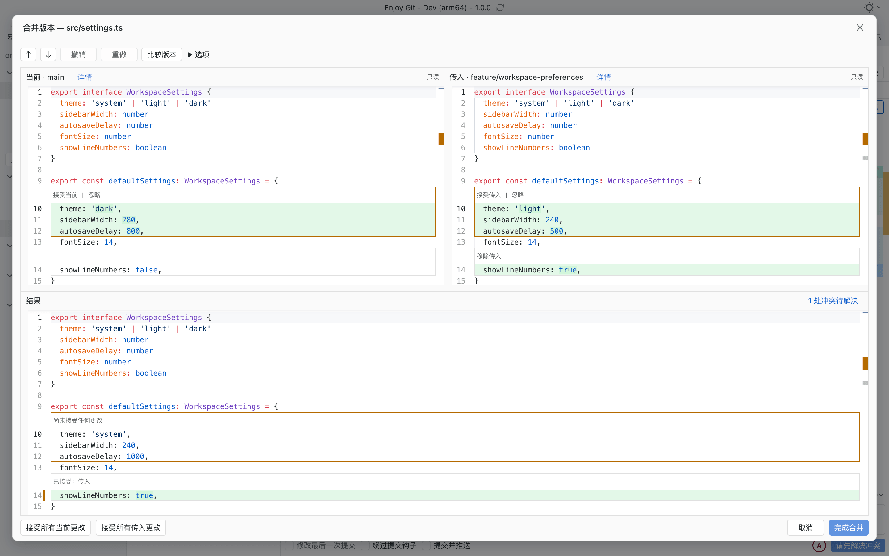](docs/images/merge-zh-CN.png)

**完成处理**：确认冲突已消除后，将结果加入暂存区，再按提示继续当前 Git 操作；合并显示工作区与暂存区时使用“标记为已解决”。冲突横幅支持逐步撤销，文件工具栏可恢复冲突状态；继续、跳过或终止入口随操作类型显示。

<a id="search"></a>

### 全文搜索、替换与编辑

目录树支持按文件名或文件内容搜索，可切换大小写、整词和正则表达式。点击结果定位到代码行，在内置编辑器中查看、替换和保存内容，修改随后回到 Git 工作区。

[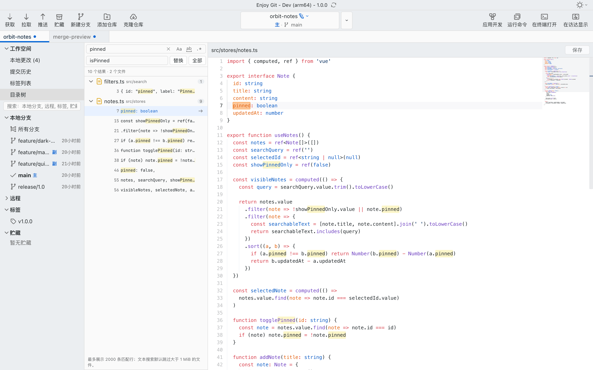](docs/images/search-zh-CN.png)

<a id="ai"></a>

### AI 提交消息

配置模型服务后，可根据代码变更生成提交消息。支持设置模型与接口地址、API Key、输出语言、上下文长度、补充指令，以及忽略文件规则；生成结果可在提交前继续编辑。

[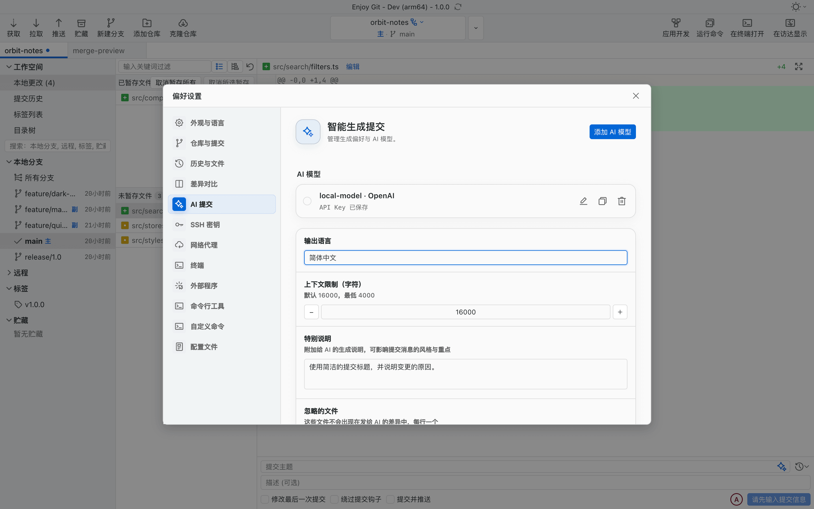](docs/images/ai-zh-CN.png)

<a id="commands"></a>

### 内置终端与命令流水线

在当前仓库打开内置终端，直接执行 Git 或项目命令；也可配置系统 / 自定义终端，并通过命令行入口打开仓库。

[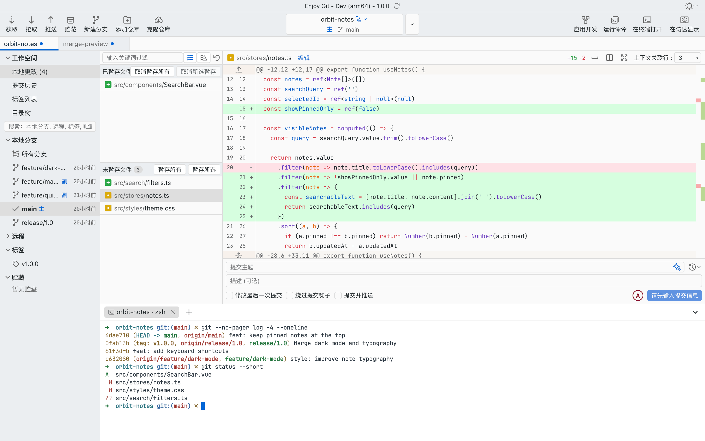](docs/images/terminal-zh-CN.png)

**自定义命令** 可按仓库配置，把本地命令、SFTP 上传和远程命令编排成流水线。任务中心提供运行记录、状态和输出，适合整理常用检查或部署步骤。

[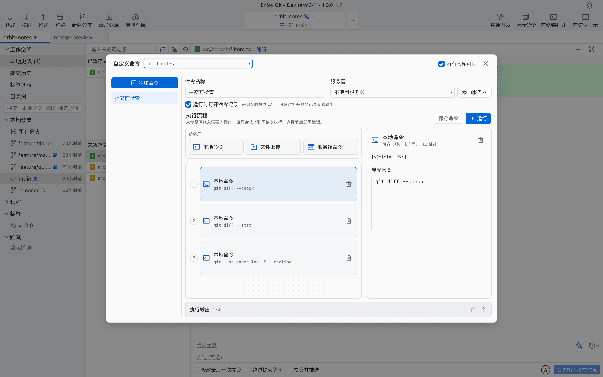](docs/images/commands-zh-CN.png)

<a id="submodules"></a>

### 子模块与连接设置

支持递归克隆、添加子模块、查看状态与检出版本。子模块差异会展示指针变化和对应提交，也可直接打开子模块仓库继续操作。

[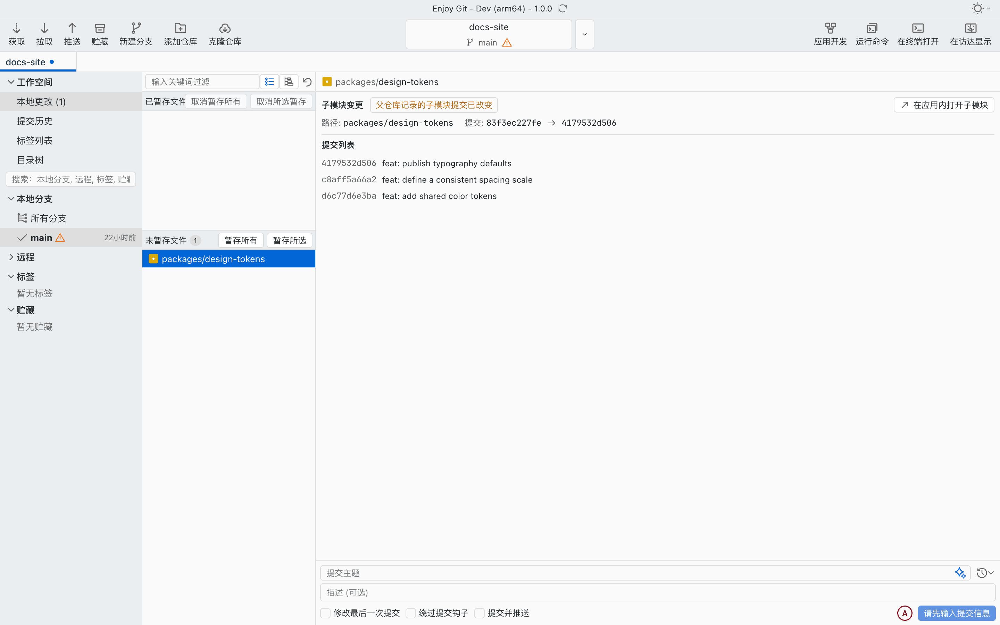](docs/images/submodules-zh-CN.png)

连接与环境设置还包括 **SSH 密钥管理、GitHub 认证、网络代理、外部打开程序**；Windows 支持接入 **WSL 仓库**。

## 语言与主题

支持简体中文、繁體中文和 English，可选择浅色、深色或跟随系统主题。三种 README 分别使用对应语言的截图。

<details>
<summary>查看深色主题</summary>

[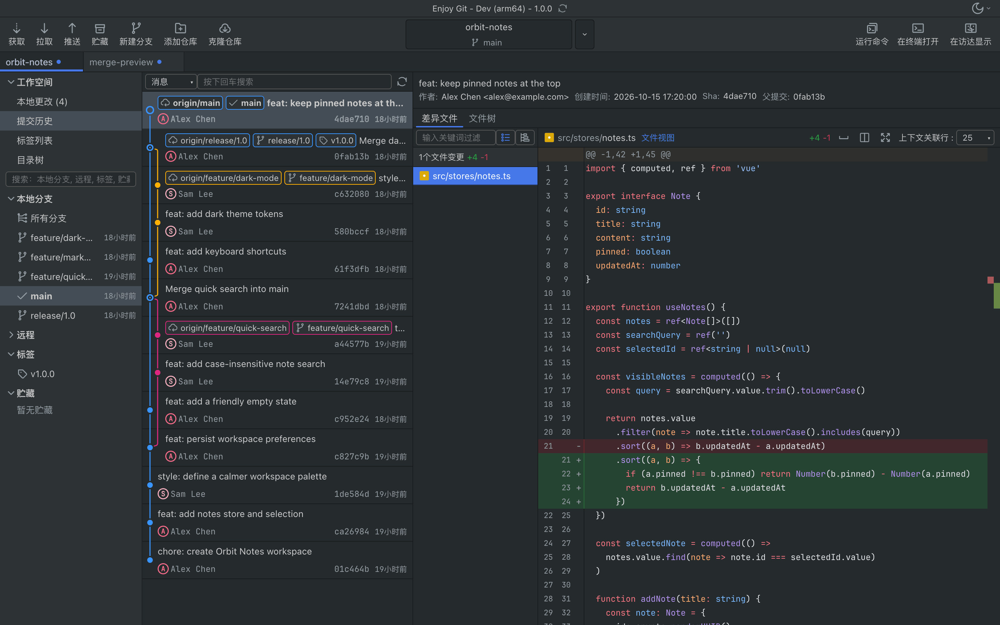](docs/images/theme-dark-zh-CN.png)

</details>

## dugite-native 与内置 Git 源码

Windows / macOS 的内置 Git 由 [dugite-native](https://github.com/desktop/dugite-native) 提供。当前资源配置使用 `v2.53.0-4`；[完整 GPL-2.0 许可](docs/licenses/dugite-native-GPL-2.0.txt)、固定版本的上游源码和构建入口见[第三方声明](THIRD_PARTY_NOTICES.md#dugite-native-and-bundled-git)。

以下调用示例展示 Git 路径、环境变量设置与子进程启动；也可直接查看[源码文件](docs/dugite-native-usage.ts)。

<details>
<summary>展开 dugite-native 调用源码</summary>

```ts
/**
 * 本软件内置的 Git 使用了 dugite-native
 * 项目地址：https://github.com/desktop/dugite-native
 */
import { spawn } from 'child_process';
import * as fs from 'fs-extra';
import * as path from 'path';

const getWin32GitSubfolder = (arch?: string): string => {
  const archRes = arch || process.arch
  if (archRes === 'x64') return 'mingw64'
  if (archRes === 'arm64') return 'clangarm64'
  return 'mingw32'
}

interface TObjectValue { [key: string]: any }

const getGitPathAndGitEnv = (envTemp?: TObjectValue) => {
  let env = { ...process.env, ...(envTemp || {}) }
  const gitFolder = path.join(__dirname, 'git')
  let gitPath = ''
  if (process.platform === 'win32') {
    const win32GitSubfolder = getWin32GitSubfolder()
    gitPath = path.join(gitFolder, 'cmd', 'git.exe')
    env.GIT_EXEC_PATH = path.join(gitFolder, win32GitSubfolder, 'libexec', 'git-core')
    env.PATH = `${gitFolder}\\${win32GitSubfolder}\\bin;${gitFolder}\\usr\\bin;${env.PATH ?? ''}`
  } else {
    gitPath = path.join(gitFolder, 'bin', 'git')
    env.GIT_CONFIG_SYSTEM = path.join(gitFolder, 'etc', 'gitconfig')
    env.GIT_EXEC_PATH = path.join(gitFolder, 'libexec', 'git-core')
    env.GIT_TEMPLATE_DIR = path.join(gitFolder, 'share', 'git-core', 'templates')
  }
  if (!fs.existsSync(gitPath)) {
    env = { ...envTemp }
    gitPath = 'git'
  }
  return { env, gitPath }
}

export const git = (args: string[], options: TObjectValue) => {
  if (!options) options = {}
  const { gitPath, env } = getGitPathAndGitEnv(options.env)
  options.env = env
  return spawn(gitPath, args, options)
}
```

</details>

## 致谢

- 提交图（Git Graph）布局和部分 SVG 绘制代码改编自 [VS Code（Code - OSS）的 Source Control History Graph](https://github.com/microsoft/vscode/blob/25c94ab342a6b167d4b97ade0829955d4f7e094e/src/vs/workbench/contrib/scm/browser/scmHistory.ts)，遵循 MIT 许可证。来源版本、版权与完整许可见[第三方声明](THIRD_PARTY_NOTICES.md)。
- Windows / macOS 内置的 Git 使用 [dugite-native](https://github.com/desktop/dugite-native) 提供的发行包。

问题与建议：[GitHub Issues](https://github.com/huangcs427/enjoy-git-release/issues) · [邮件](mailto:huangcs427@163.com) · [隐私政策](https://enjoygit.com/privacyPolicy.html)
