<p align="center">
  
</p>

<h1 align="center">Enjoy Git</h1>

<p align="center">讓日常 Git 操作更直觀。</p>

<p align="center">
  <a href="README.md">简体中文</a> · <strong>繁體中文</strong> · <a href="README.en.md">English</a>
</p>

<p align="center">
  <a href="https://github.com/huangcs427/enjoy-git-release/releases/latest">下載最新版本</a> · <a href="https://enjoygit.com">官網</a> · <a href="https://github.com/huangcs427/enjoy-git-release/issues">回報問題</a>
</p>

Enjoy Git 是一款適用於 **macOS、Windows 和 Linux** 的桌面 Git 客戶端，將程式碼差異、提交紀錄和衝突處理整合在直觀的介面中。

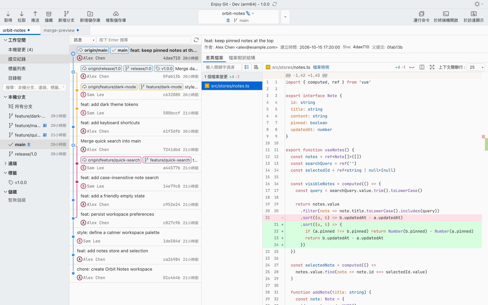

## 下載與安裝

從 [GitHub Releases](https://github.com/huangcs427/enjoy-git-release/releases/latest) 下載適合你的系統和處理器架構的安裝套件。

| 平台 | 安裝套件 | 架構 |
| --- | --- | --- |
| Windows | `.exe` | x64、arm64 |
| macOS | `.dmg` | x64（Intel）、arm64（Apple Silicon） |
| Linux | `.deb`、`.rpm` | x64、arm64 |

Windows 和 macOS **內建 Git**，安裝後即可使用；Linux 需先安裝系統 Git。

## 快速開始

1. **開啟專案**：加入本機儲存庫、複製遠端儲存庫，或掃描目錄批次匯入。
2. **準備提交**：在「本機變更」中審閱差異，按檔案或選取行暫存，填寫提交標題和內文後提交。
3. **同步與協作**：設定遠端和追蹤分支後擷取、拉取、推送；需要同時處理多個任務時建立工作樹。

## 功能導覽

點擊圖片可檢視原圖。

[儲存庫接入與專案整理](#repositories) · [工作區、差異與按行暫存](#changes) · [提交紀錄與 Git Graph](#history) · [挑選提交與整理歷史](#cherry-pick) · [檔案歷史與逐行檢視](#file-history) · [分支、遠端、標籤與儲藏](#branches) · [工作樹切換與並行開發](#worktrees) · [檔案內衝突處理與三欄合併](#conflicts) · [全文搜尋、取代與編輯](#search) · [AI 提交訊息](#ai) · [內建終端機與命令流水線](#commands) · [子模組與連線設定](#submodules)

<a id="repositories"></a>

### 儲存庫接入與專案整理

支援建立儲存庫、複製、加入本機儲存庫，以及掃描目錄。專案可設定別名並按組整理，在分頁或快速切換視窗中搜尋和切換。

[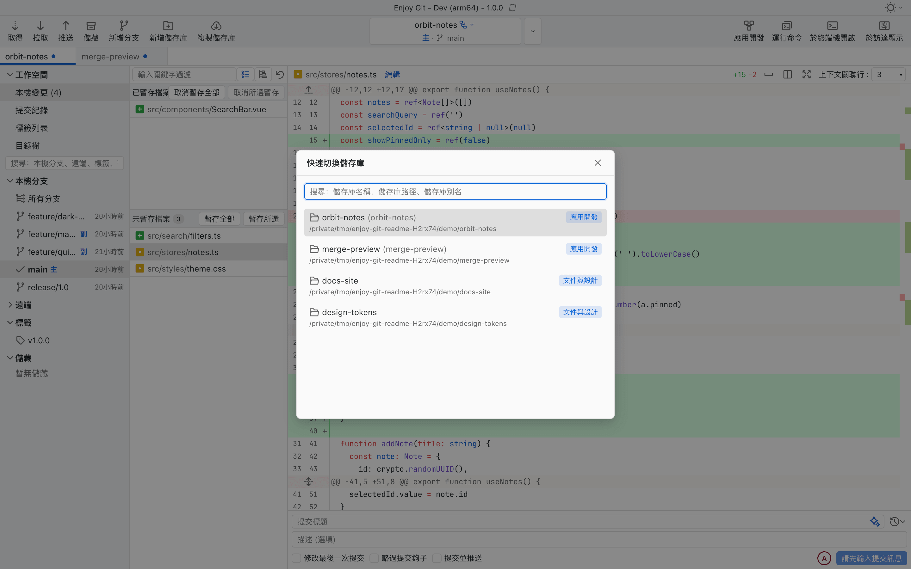](docs/images/repositories-zh-HK.png)

<a id="changes"></a>

### 工作區、差異與按行暫存

已暫存與未暫存檔案分區顯示，可使用清單或檔案樹。差異支援統一 / 並排檢視、語法高亮、忽略空白字元、展開上下文，以及圖片和 SVG 預覽。

[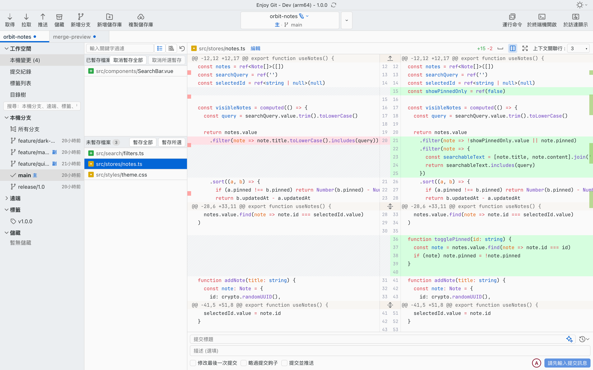](docs/images/workspace-zh-HK.png)

**只提交部分變更**：在 diff 中選取需要的程式碼行，按右鍵選擇「將選取行加入暫存區」；已暫存內容亦可按行移出，未暫存內容可按行捨棄。

[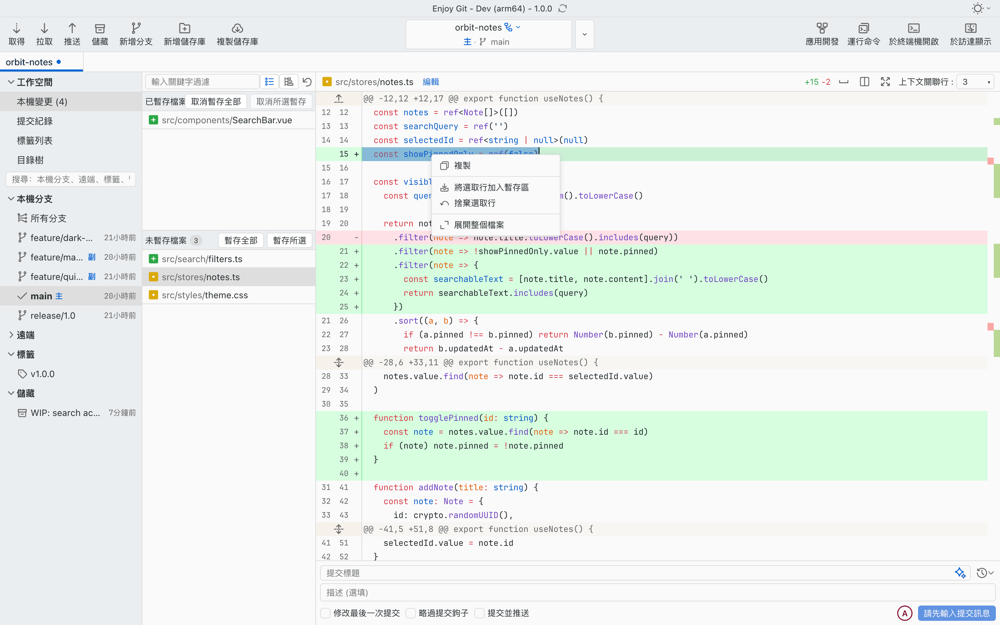](docs/images/line-staging-zh-HK.png)

**提交與修訂**：填寫提交標題與內文，亦可點擊歷史按鈕重用最近的提交訊息，再按本次變更調整。表單支援修改最後一次提交（Amend）、略過提交鉤子和提交並推送；點擊提交身分可修改姓名和電郵。

[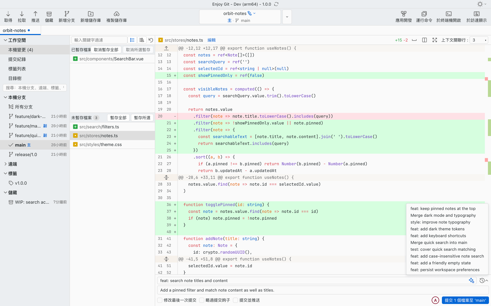](docs/images/commit-message-zh-HK.png)

<a id="history"></a>

### 提交紀錄與 Git Graph

分支提交圖顯示提交、分叉、合併、標籤及本機 / 遠端分支的位置。選擇提交即可檢視作者、時間、SHA、變更檔案和程式碼差異，亦可切換至檔案樹瀏覽該版本的內容。

**搜尋紀錄**：可按提交訊息、差異內容或作者搜尋，檢視符合數量，並用 Enter / Shift + Enter 在結果之間跳轉。

[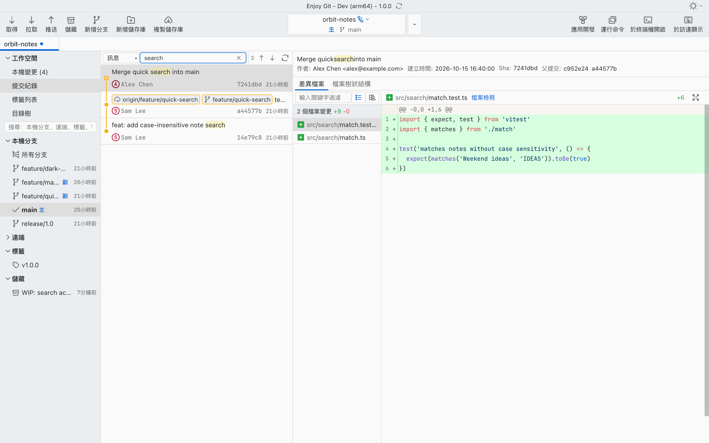](docs/images/history-search-zh-HK.png)

<a id="cherry-pick"></a>

### 挑選提交與整理歷史

**挑選提交（Cherry-pick）** 將選取的提交套用至目標分支。使用 Cmd（macOS）/ Ctrl（Windows、Linux）點擊多選，或使用 Shift 連續選取，按右鍵開啟「挑選提交」，再選擇目標分支。多個提交會按先舊後新的順序套用；如果目標分支已在另一個工作樹檢出，會先提示切換至該工作樹。

[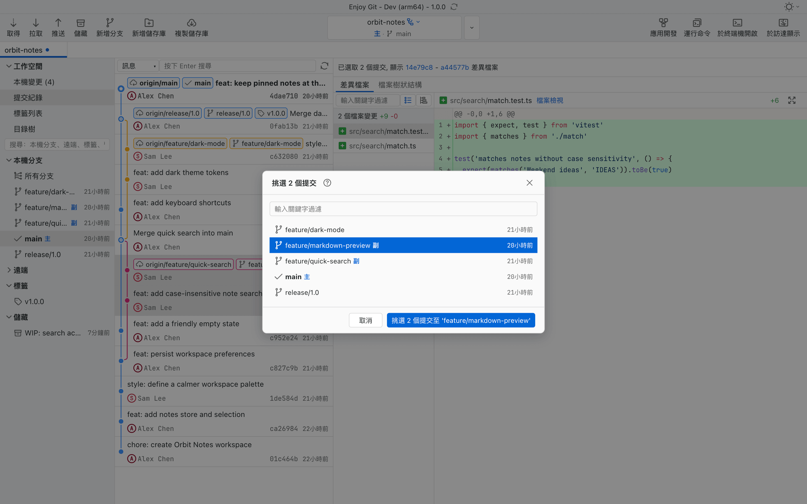](docs/images/cherry-pick-zh-HK.png)

提交右鍵選單亦提供還原提交（Revert）、撤回最近提交、合併提交（Squash）、編輯提交訊息、重新排序和刪除提交等操作；可用項會隨目前分支、提交位置和選區變化。分支選單支援合併和變基（Rebase）。

<a id="file-history"></a>

### 檔案歷史與逐行檢視

**檔案歷史**：在檔案右鍵選單中選擇「檢視檔案歷史紀錄」，於獨立視窗逐次檢視該檔案的提交與 diff，並按分支和關鍵字篩選。

[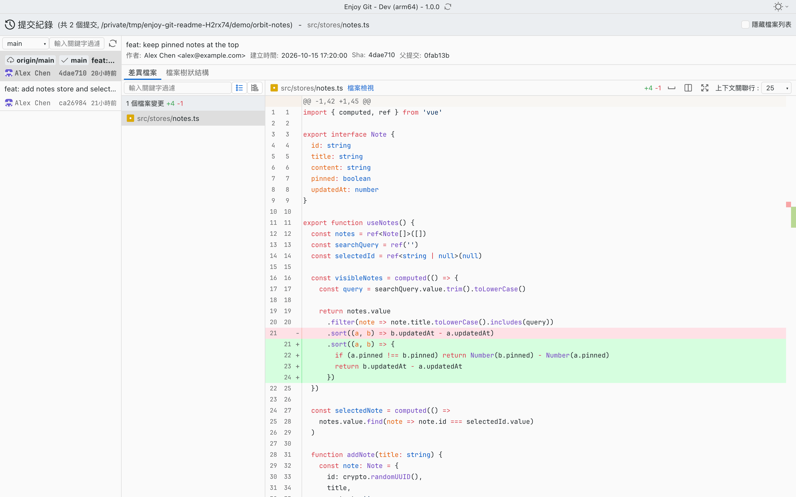](docs/images/file-history-zh-HK.png)

**逐行檢視（Blame）**：檢視每一行最後修改它的提交、作者和日期。點擊左側的提交歸屬可突出顯示對應程式碼行，並與檔案提交清單對照，追溯一段程式碼的來源。

[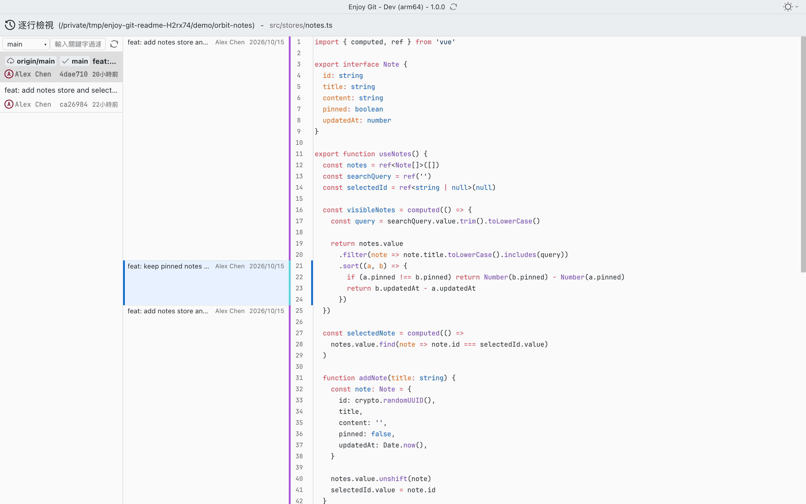](docs/images/blame-zh-HK.png)

<a id="branches"></a>

### 分支、遠端、標籤與儲藏

支援建立、檢出、重新命名和刪除分支，管理追蹤關係與多個遠端，並使用 Fetch / Pull / Push 同步。推送前可明確選擇本機分支、遠端和目標分支；標籤支援建立、瀏覽、檢出和刪除。

[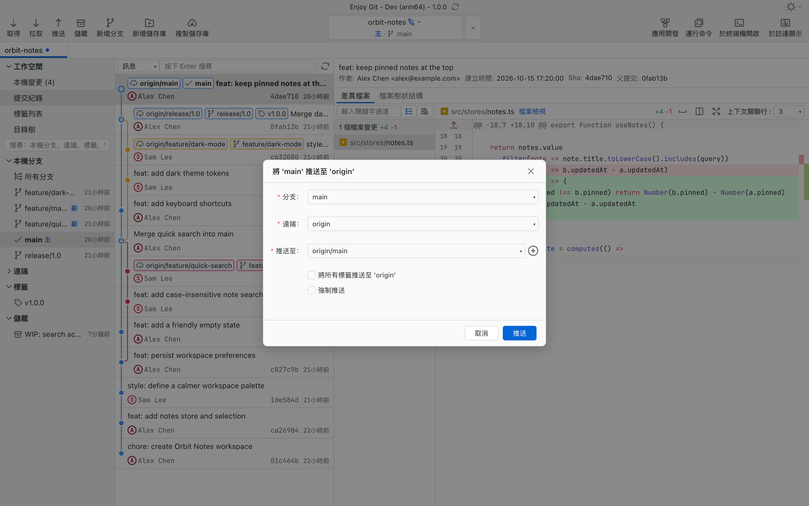](docs/images/branch-sync-zh-HK.png)

**儲藏（Stash）** 可保存手頭任務，之後檢視已儲存的檔案與差異，再選擇套用、彈出或刪除。適合在切換工作內容前保存尚未提交的變更。

[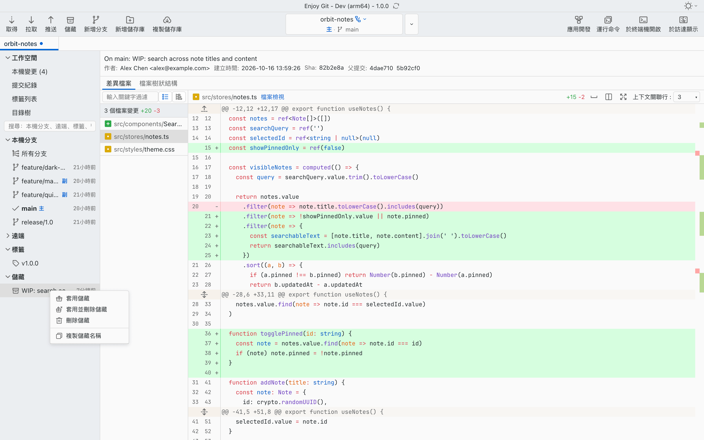](docs/images/stash-zh-HK.png)

<a id="worktrees"></a>

### 工作樹切換與並行開發

工作樹（Git Worktree）讓同一儲存庫的不同分支各自擁有工作目錄。可以保留目前任務的變更，同時在另一目錄處理修復或新功能。

**切換現有工作樹**：點擊頂部儲存庫區域，清單會同時顯示工作目錄與分支，並標記目前項目。下圖已切換至 `feature/quick-search` 所在工作樹，可隨時切回主工作樹。

[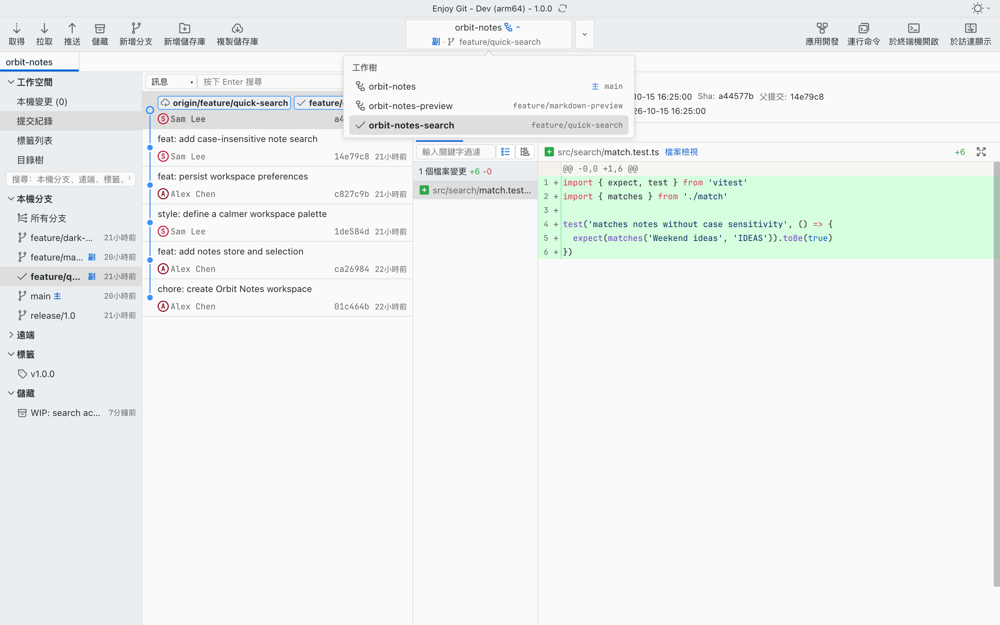](docs/images/worktree-switch-zh-HK.png)

**建立工作樹**：在儲存庫入口按右鍵選擇「新增工作樹」，指定目錄和分支；亦可建立新分支，並按需重用 Git 忽略的目錄和檔案。建立完成後會切換至新工作樹。

[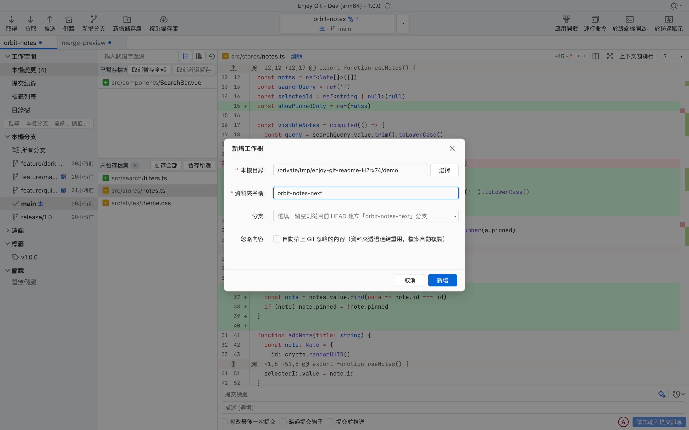](docs/images/worktrees-zh-HK.png)

<a id="conflicts"></a>

### 檔案內衝突處理與三欄合併

合併、拉取、變基、挑選提交等操作產生文字衝突時，可按需要選擇檔案內選邊、手動編輯或三欄合併。

**直接在衝突檔案中解決**：在「本機變更」中選取衝突檔案，檢視高亮的衝突標記，逐塊點擊「採用目前變更」「採用傳入的變更」或「保留雙方變更」。多處衝突可前後跳轉，亦可透過「批次處理」統一選邊。

[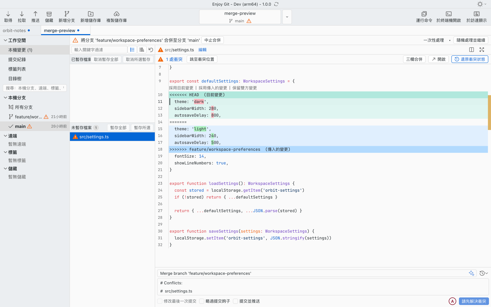](docs/images/conflict-inline-zh-HK.png)

**手動編輯衝突檔案**：點擊檔案上方的「編輯」，直接修改檔案內容，整合雙方邏輯並清理衝突標記，再儲存結果。下圖顯示手動整合設定後的草稿與儲存入口。

[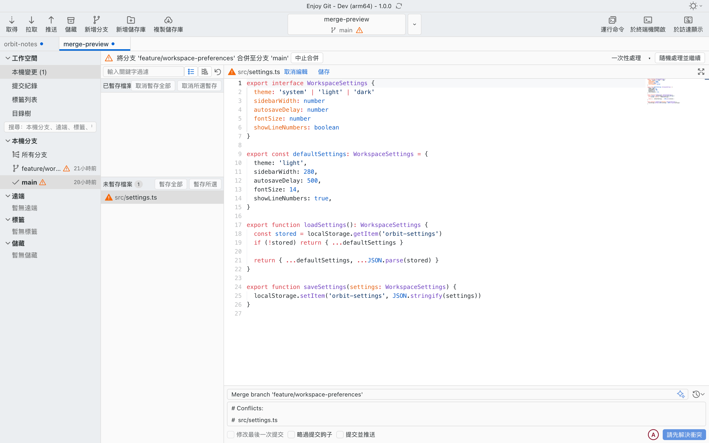](docs/images/conflict-edit-zh-HK.png)

**三欄合併**：需要對照雙方版本時，開啟「三欄合併」，在雙方內容和可編輯結果之間比較、選邊或組合變更。支援版本比較、復原 / 重做。

[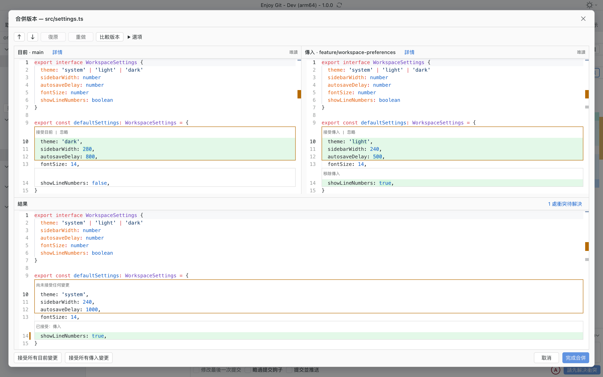](docs/images/merge-zh-HK.png)

**完成處理**：確認衝突已消除後，將結果加入暫存區，再按提示繼續目前 Git 操作；合併顯示工作區與暫存區時使用「標記為已解決」。衝突橫幅支援逐步復原，檔案工具列可還原衝突狀態；繼續、跳過或中止入口會隨操作類型顯示。

<a id="search"></a>

### 全文搜尋、取代與編輯

目錄樹支援按檔案名稱或內容搜尋，可切換大小寫、全字和正規表示式。點擊結果定位至程式碼行，在內建編輯器檢視、取代和儲存內容，變更隨後回到 Git 工作區。

[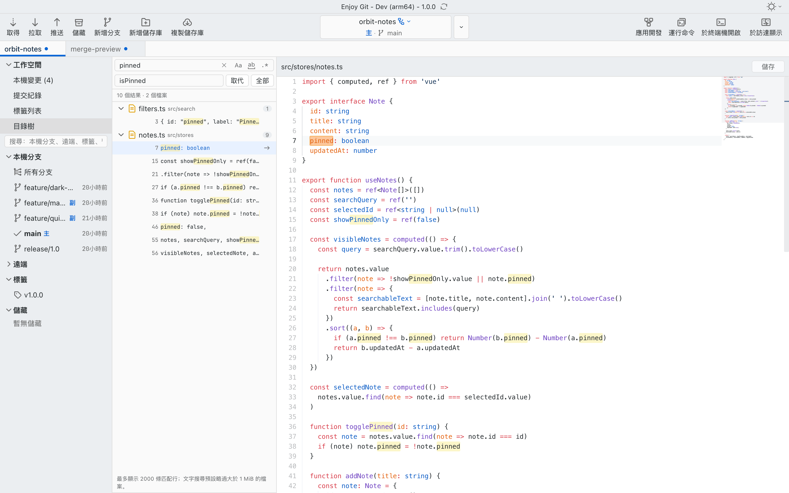](docs/images/search-zh-HK.png)

<a id="ai"></a>

### AI 提交訊息

設定模型服務後，可根據程式碼變更產生提交訊息。支援設定模型與介面網址、API Key、輸出語言、上下文長度、補充指示，以及忽略檔案規則；產生的結果可在提交前繼續編輯。

[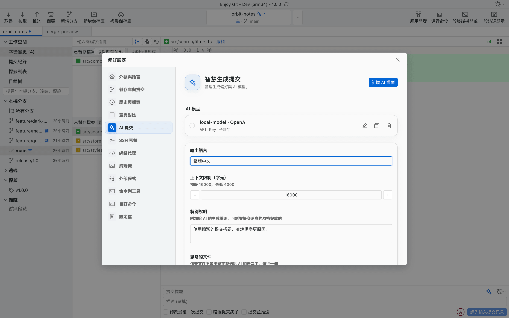](docs/images/ai-zh-HK.png)

<a id="commands"></a>

### 內建終端機與命令流水線

在目前儲存庫開啟內建終端機，直接執行 Git 或專案命令；亦可設定系統 / 自訂終端機，並透過命令列入口開啟儲存庫。

[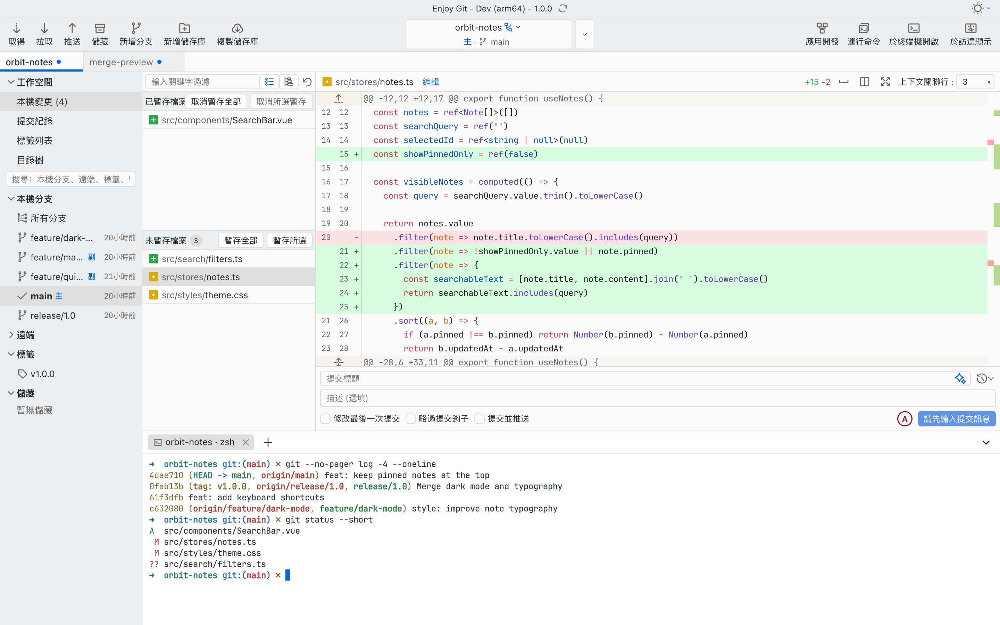](docs/images/terminal-zh-HK.png)

**自訂命令** 可按儲存庫設定，將本機命令、SFTP 上傳和遠端命令編排為流水線。工作中心提供執行紀錄、狀態和輸出，適合整理常用檢查或部署步驟。

[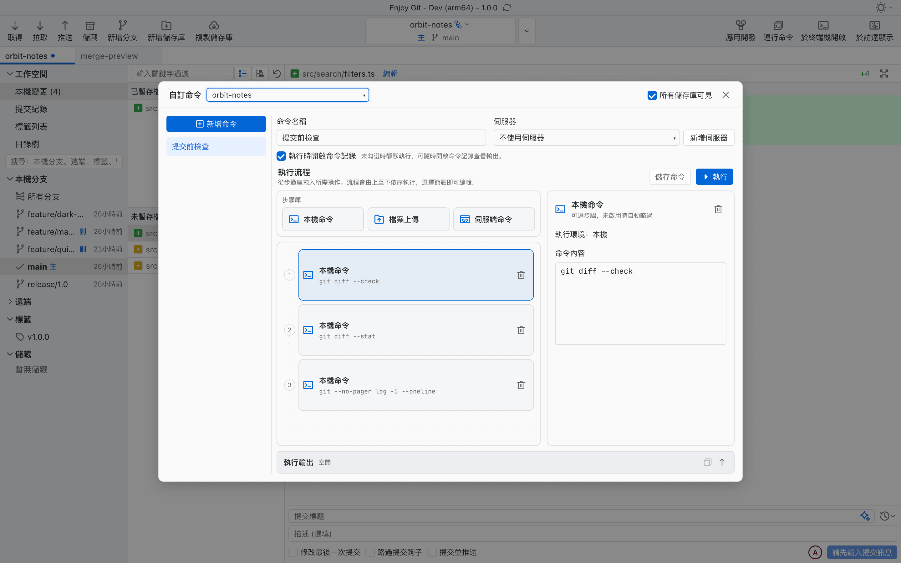](docs/images/commands-zh-HK.png)

<a id="submodules"></a>

### 子模組與連線設定

支援遞迴複製、新增子模組、檢視狀態與檢出版本。子模組差異會顯示指標變化和對應提交，亦可直接開啟子模組儲存庫繼續操作。

[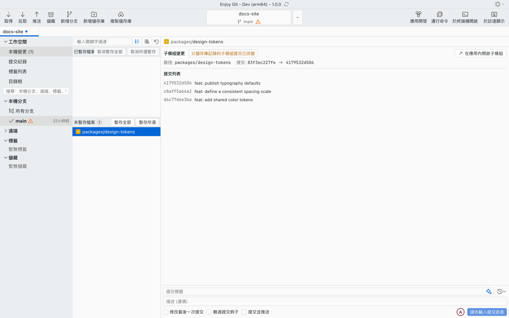](docs/images/submodules-zh-HK.png)

連線與環境設定亦包括 **SSH 金鑰管理、GitHub 認證、網絡代理、外部開啟程式**；Windows 支援接入 **WSL 儲存庫**。

## 語言與主題

支援簡體中文、繁體中文和 English，可選擇淺色、深色或跟隨系統主題。

<details>
<summary>檢視深色主題</summary>

[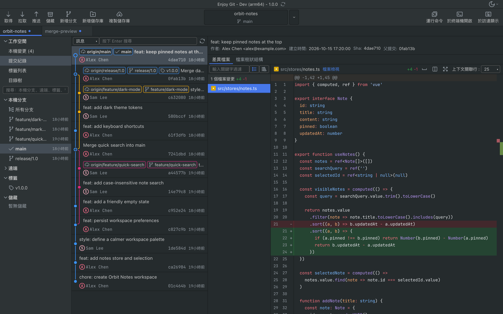](docs/images/theme-dark-zh-HK.png)

</details>

## dugite-native 與內建 Git 原始碼

Windows / macOS 的內建 Git 由 [dugite-native](https://github.com/desktop/dugite-native) 提供。目前資源設定使用 `v2.53.0-4`；[完整 GPL-2.0 授權條款](docs/licenses/dugite-native-GPL-2.0.txt)、固定版本的上游原始碼和建置入口見[第三方聲明](THIRD_PARTY_NOTICES.md#dugite-native-and-bundled-git)。

以下呼叫範例展示 Git 路徑、環境變數設定與子程序啟動；亦可直接檢視[原始碼檔案](docs/dugite-native-usage.ts)。

<details>
<summary>展開 dugite-native 呼叫原始碼</summary>

```ts
/**
 * 本軟件內建的 Git 使用 dugite-native
 * https://github.com/desktop/dugite-native
 */
import { spawn } from 'child_process';
import * as fs from 'fs-extra';
import * as path from 'path';

const getWin32GitSubfolder = (arch?: string): string => {
  const archRes = arch || process.arch
  if (archRes === 'x64') return 'mingw64'
  if (archRes === 'arm64') return 'clangarm64'
  return 'mingw32'
}

interface TObjectValue { [key: string]: any }

const getGitPathAndGitEnv = (envTemp?: TObjectValue) => {
  let env = { ...process.env, ...(envTemp || {}) }
  const gitFolder = path.join(__dirname, 'git')
  let gitPath = ''
  if (process.platform === 'win32') {
    const win32GitSubfolder = getWin32GitSubfolder()
    gitPath = path.join(gitFolder, 'cmd', 'git.exe')
    env.GIT_EXEC_PATH = path.join(gitFolder, win32GitSubfolder, 'libexec', 'git-core')
    env.PATH = `${gitFolder}\\${win32GitSubfolder}\\bin;${gitFolder}\\usr\\bin;${env.PATH ?? ''}`
  } else {
    gitPath = path.join(gitFolder, 'bin', 'git')
    env.GIT_CONFIG_SYSTEM = path.join(gitFolder, 'etc', 'gitconfig')
    env.GIT_EXEC_PATH = path.join(gitFolder, 'libexec', 'git-core')
    env.GIT_TEMPLATE_DIR = path.join(gitFolder, 'share', 'git-core', 'templates')
  }
  if (!fs.existsSync(gitPath)) {
    env = { ...envTemp }
    gitPath = 'git'
  }
  return { env, gitPath }
}

export const git = (args: string[], options: TObjectValue) => {
  if (!options) options = {}
  const { gitPath, env } = getGitPathAndGitEnv(options.env)
  options.env = env
  return spawn(gitPath, args, options)
}
```

</details>

## 鳴謝

- 提交圖（Git Graph）佈局和部分 SVG 繪製程式碼改編自 [VS Code（Code - OSS）的 Source Control History Graph](https://github.com/microsoft/vscode/blob/25c94ab342a6b167d4b97ade0829955d4f7e094e/src/vs/workbench/contrib/scm/browser/scmHistory.ts)，遵循 MIT 授權條款。來源版本、版權與完整授權條款見[第三方聲明](THIRD_PARTY_NOTICES.md)。
- Windows / macOS 內建的 Git 使用 [dugite-native](https://github.com/desktop/dugite-native) 提供的發行套件。

問題與建議：[GitHub Issues](https://github.com/huangcs427/enjoy-git-release/issues) · [電郵](mailto:huangcs427@163.com) · [私隱政策](https://enjoygit.com/privacyPolicy.html)
